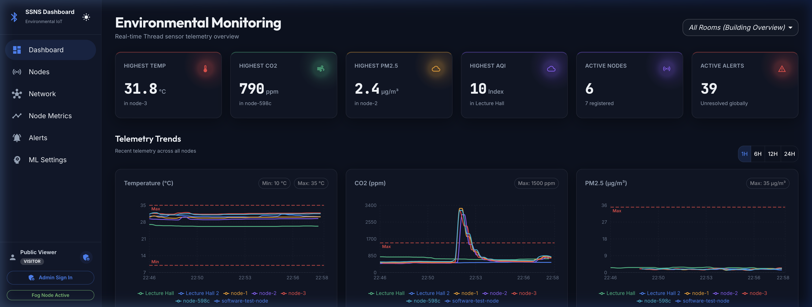
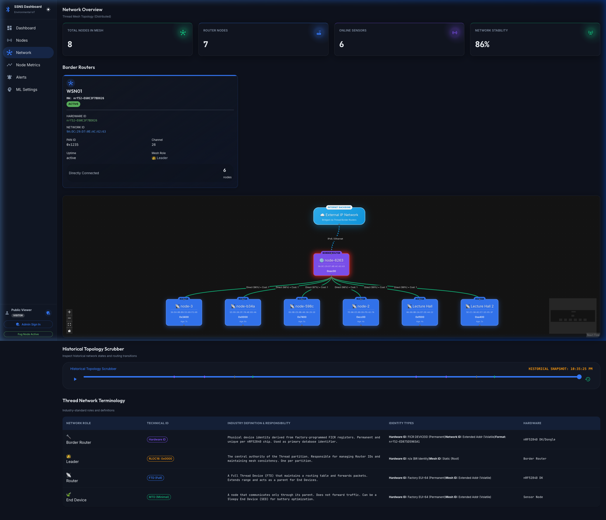
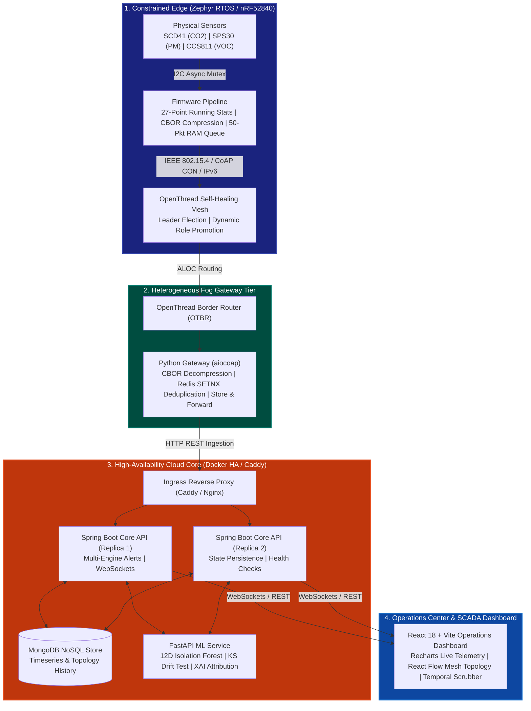
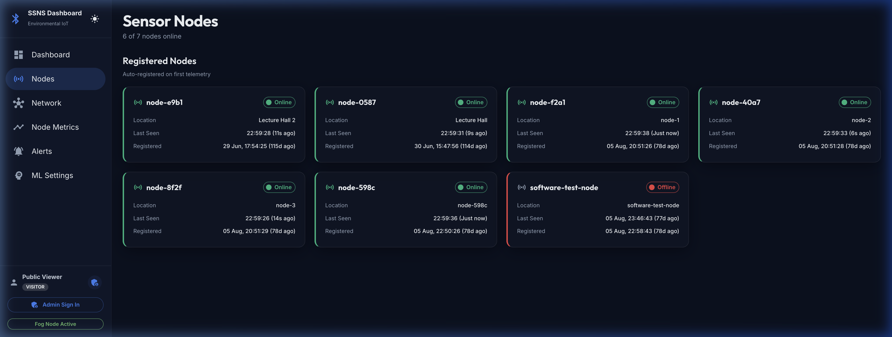
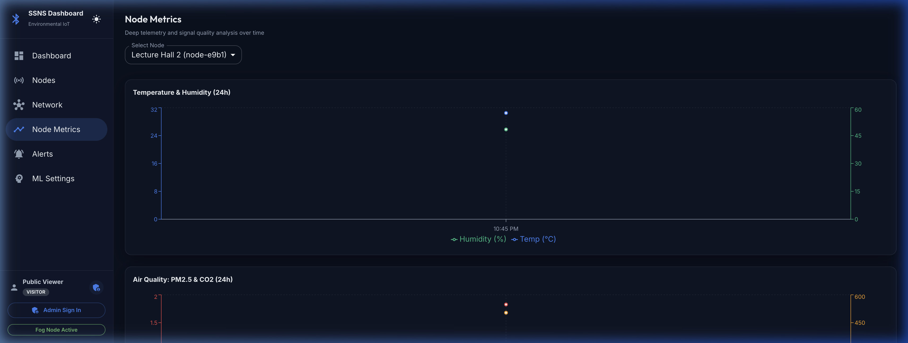
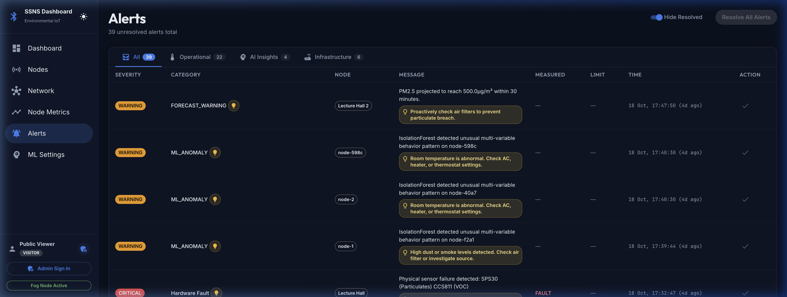
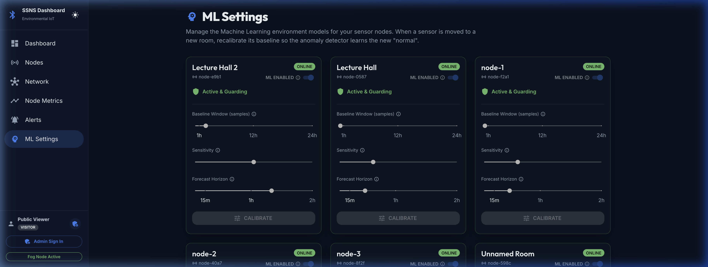

# Smart Sensor Network System (SSNS)
### Fault-Tolerant OpenThread Mesh IoT Platform for Indoor Environmental & Safety Monitoring

<p align="center">
  <a href="https://ssns-iot.com"></a>
  <a href="https://openthread.io/"></a>
  <a href="https://zephyrproject.org/"></a>
  <a href="platform/api"></a>
  <a href="platform/ml-service"></a>
  <a href="platform/dashboard"></a>
  <a href="https://www.docker.com/"></a>
  <a href="docs/01-final-deliverables/report/ieee-report.pdf"></a>
</p>

> 🌐 **Live Cloud Deployment:** **[https://ssns-iot.com](https://ssns-iot.com)**  
> *Production environment streaming live environmental telemetry from 6 physical sensor nodes.*
> 
> 💻 **Project Website & Architecture Tour:** **[https://muhammadsaleem-dev.github.io/ssns-openthread-iot/](https://muhammadsaleem-dev.github.io/ssns-openthread-iot/)**  
> *Interactive walkthrough with high-resolution screenshot gallery, technical specifications, and IEEE report.*
> 
> **Author & Lead Engineer:** **Muhammad Saleem**  
> *M.Sc. High Integrity Systems, Frankfurt University of Applied Sciences, Germany*

---

<p align="center">
  <a href="https://ssns-iot.com" target="_blank">
    
  </a>
  <em>Figure 1: SSNS Operations Center — Real-time telemetry streaming across 6 physical sensor nodes with live multi-room trend charts and KPI thresholds.</em>
</p>

---

## 🌟 Executive Summary

The **Smart Sensor Network System (SSNS)** is a fault-tolerant, distributed IoT platform engineered for mission-critical indoor air quality (IAQ) and safety monitoring. Moving beyond standard single-parameter alarms or cloud-dependent sensor hubs, SSNS unifies:

1. **IPv6 OpenThread 802.15.4 Mesh Networking:** Self-healing, multi-hop radio infrastructure running Zephyr RTOS on Nordic nRF52840 hardware.
2. **Heterogeneous Fog Tier:** Autonomous edge gateways providing protocol translation, deduplication, and store-and-forward persistence.
3. **Multi-Engine Alert Pipeline:** High-speed parallel evaluation across deterministic thresholds (ASHRAE, OSHA, WHO, EPA, WELL v2), noise-floor-clamped rolling heuristics, and hardware health bitmasks.
4. **Machine Learning & Predictive Intelligence:** An unsupervised Isolation Forest anomaly detection engine with dynamic drift adaptation (Kolmogorov-Smirnov) and R²-gated trend forecasting.
5. **Historical Topology Scrubber & Temporal State Playback:** Deterministic auditing and frame-by-frame visual verification of OpenThread self-healing, dynamic role promotions, and leader elections.

---

## ⏱️ Historical Topology Scrubber & Temporal State Playback

Developed to empirically validate autonomous mesh resilience, the **Topology Scrubber** enables operators to audit and reconstruct chronological network topology states deterministically.

<p align="center">
  
  <em>Figure 2: Interactive React Flow mesh visualizer with frame-by-frame temporal scrubber, automated differential event markers, and Thread role diagnostics.</em>
</p>

### Key Technical Capabilities:
* **Frame-by-Frame Topology Auditing:** The Spring Boot backend continuously records multi-node network states into MongoDB (`NetworkTopologyHistory`), capturing node roles (`LEADER`, `ROUTER`, `CHILD`, `DETACHED`), route costs, link qualities, and gateway health.
* **Automated Differential Event Markers:** The frontend timeline scans adjacent frames and highlights critical occurrences with color-coded markers:
  * 🔴 **Red Marker:** Edge gateway outage or recovery transition.
  * 🟠 **Orange Marker:** Thread Leader election resulting from partitions or re-elections.
  * 🟢 / ⚪ **Green/Grey Marker:** Nodes joining or ungracefully dropping from the mesh.
  * 🟣 **Purple Marker (Self-Healing Promotion):** Directly captures OpenThread's self-healing role transitions (e.g., when a `Child` node automatically promotes itself to a `Router` to maintain packet paths during node dropouts).
* **Smooth Playback & Dynamic Visualization:** Operators can play back network events at configurable speeds or scrub directly to points of interest. Nodes visually pulse to indicate leader authority, and link lines update dynamically with empirical quality percentages without DOM thrashing or transient edge crashes.

---

## 🧭 Multi-Tier System Architecture



---

## 🖥️ Platform Showcase

| **Sensor Nodes & Hardware Inventory** | **Node Metrics & Link Quality** |
| :---: | :---: |
|  |  |
| *Real-time status, hardware addresses, and spatial allocations across all monitored indoor rooms.* | *Per-node hardware diagnostics, packet transmission rates, RSSI link quality, and battery levels.* |

| **Multi-Engine Alerts & Safety Bounds** | **ML Anomaly Detection (Isolation Forest)** |
| :---: | :---: |
|  |  |
| *Deterministic safety compliance (OSHA/ASHRAE/WHO) combined with noise-floor-clamped heuristic spike detection.* | *Real-time unsupervised anomaly scoring with Kolmogorov-Smirnov drift testing and dynamic threshold adaptation.* |

---

## 🔬 Core Subsystems & Technical Rigor

### 1. Embedded Firmware & Hardware Tier ([`firmware/`](firmware))
* **Microcontroller:** Nordic Semiconductor nRF52840 running Zephyr RTOS v3.x.
* **Sensor Suite:** 
  * **Sensirion SCD41:** Photoacoustic NDIR CO₂ (400 – 5,000 ppm, ±(50 ppm + 3%)).
  * **Sensirion SPS30:** Laser scattering particulate counter (PM₁.₀, PM₂.₅, PM₄.₀, PM₁₀).
  * **ScioSense CCS811:** Metal-oxide TVOC sensor (0 – 1,187 ppb).
* **Hardware Producer-Consumer Model:** Dedicated Zephyr threads poll I2C sensors at hardware-native rates (1.0s to 5.5s), computing 27-element statistical vectors (Mean, Max, StdDev) in shared memory under Mutex locks before CoAP transmission.
* **Offline Fault Tolerance:** On-chip 50-packet volatile RAM buffer providing **25 minutes of continuous data retention** during complete radio or gateway blackout.

### 2. Fog Computing Layer ([`edge-nodes/`](edge-nodes))
* **Border Router (OTBR):** Connects the 802.15.4 radio mesh to standard IPv6 networks.
* **Autonomous Python Gateway:** Asynchronous `aiocoap` listener decompressing CBOR payloads.
* **Zero-Loss Queueing:** Redis-backed `SETNX` deduplication (300s TTL) and exponential backoff retry queue (`LPUSH`/`LPOP`) ensuring zero dropped packets during WAN disconnections.
* **Heterogeneous Cross-Platform Support:** Validated on native Linux, macOS (with custom socket-serial bridge), and Windows WSL2.

### 3. Backend & Multi-Engine Alerting Platform ([`platform/api`](platform/api))
* **Java 17 / Spring Boot 3:** High-throughput, stateless ingestion microservices horizontally scalable behind Nginx/Caddy.
* **Parallel Alert Engines:**
  * **Static Engine:** Enforces international health bounds: CO₂ > 1,500 ppm (ASHRAE), PM₂.₅ > 35 µg/m³ (EPA NAAQS), TVOC > 1,000 ppb (WELL v2), Temperature 10°C – 35°C (ASHRAE 55), Humidity 20% – 60% (OSHA).
  * **Heuristic Engine:** Evaluates rolling 30-sample statistics clamped against sensor physical noise floors; detects rapid VOC spikes (1.5σ) and multi-sensor fusion cleaning events.
  * **Hardware Engine:** Evaluates 8-bit sensor health status masks and isolates sentinel errors (-999.0).
  * **Distributed Debounce:** 300-second suppression window preventing cascading alert storms.

### 4. Machine Learning & Forecasting Service ([`platform/ml-service`](platform/ml-service))
* **Unsupervised Anomaly Detection:** Scikit-Learn **Isolation Forest** operating on a 12-dimensional feature space (5 primary sensor channels, 5 first-order rate-of-change derivatives, 2 cyclical temporal encodings).
* **Drift Adaptation:** Two-sample Kolmogorov-Smirnov statistical test (p < 0.25) triggering robust median/IQR normalization rescaling without destabilizing the ensemble tree structures.
* **Explainable AI (XAI):** Real-time Z-score attribution isolating the exact physical sensor driving each anomaly.
* **Trend Forecaster:** Linear trend projection with R² ≥ 0.65 correlation gating and EMA smoothing over 30-minute horizons.

---

## 📊 Empirical Evaluation Summary

Results evaluated across 2.8-day continuous real-room empirical telemetry:

| Metric | Result | Target Benchmark |
| :--- | :--- | :--- |
| **True Positive Rate (TPR)** | **77.31%** | > 75% on safety breaches |
| **False Positive Rate (FPR)** | **0.45%** | < 1.0% operational false alarms |
| **Detection Latency (CO₂)** | **584 seconds** | Within 900s hazardous ramp |
| **Partition Self-Healing** | **100% Autonomous** | Zero manual operator intervention |
| **Edge RAM Queue Coverage** | **25 Minutes** | Full packet preservation |

---

## 🚀 Quick Start Guide

### Prerequisites
* Docker & Docker Compose v2.x
* Java 17+ & Maven (for native backend build)
* Node.js v18+ & npm (for dashboard)
* Python 3.10+ (for ML service and gateway)

### 1. Launch Platform Core via Docker Compose
```bash
# Clone the repository
git clone https://github.com/muhammadsaleem-dev/ssns-openthread-iot.git
cd ssns-openthread-iot

# Start MongoDB, Redis, API replicas, ML service, and Dashboard
docker compose -f platform/docker-compose.ha.yml up -d
```

### 2. Access Web Dashboard
Open your browser and navigate to:
* **Dashboard & Topology Scrubber:** `http://localhost:3000`
* **Spring Boot API Swagger/Health:** `http://localhost:8080/actuator/health`
* **ML Service Docs:** `http://localhost:8000/docs`

### 3. Run Reliability & Chaos Test Suite
To stress-test fault-tolerance, dynamic leader failover, and queue recovery:
```bash
# Execute chaos engineering suite
./chaos_stress_test.sh

# Run end-to-end alert verification
./test_static_alerts.sh
```

---

## 📑 Academic Documentation & Deliverables

| Document | Format | Description |
| :--- | :--- | :--- |
| [**Project Technical Report (IEEE Format)**](docs/01-final-deliverables/report/ieee-report.pdf) | PDF (9 Pages) | Formal academic-grade technical report with mathematical models, architecture, and empirical evaluation |
| [**LaTeX Source Code**](docs/01-final-deliverables/report/ieee-report.tex) | LaTeX (.tex) | Full IEEEtran formatted manuscript source |
| [**AI Interaction Appendix**](docs/01-final-deliverables/ai-interaction/ai-usage-appendix.pdf) | PDF (8 Pages) | Detailed audit of AI assistant engineering usage and verification workflows |
| [**Hardware Wiring Blueprint**](docs/03-hardware/wiring.md) | Markdown | Complete I2C pin mapping, power considerations, and board schematics |
| [**System Documentation Index**](docs/README.md) | Markdown | Detailed directory of all subsystem technical specifications |

---

## 👨‍💻 Author

**Muhammad Saleem**  
*M.Sc. High Integrity Systems*  
Frankfurt University of Applied Sciences, Frankfurt am Main, Germany  
Contact: [muhammadsaleem.dev@gmail.com](mailto:muhammadsaleem.dev@gmail.com)  
GitHub: [@muhammadsaleem-dev](https://github.com/muhammadsaleem-dev)
