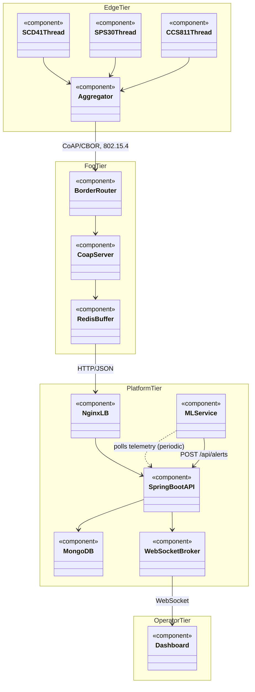
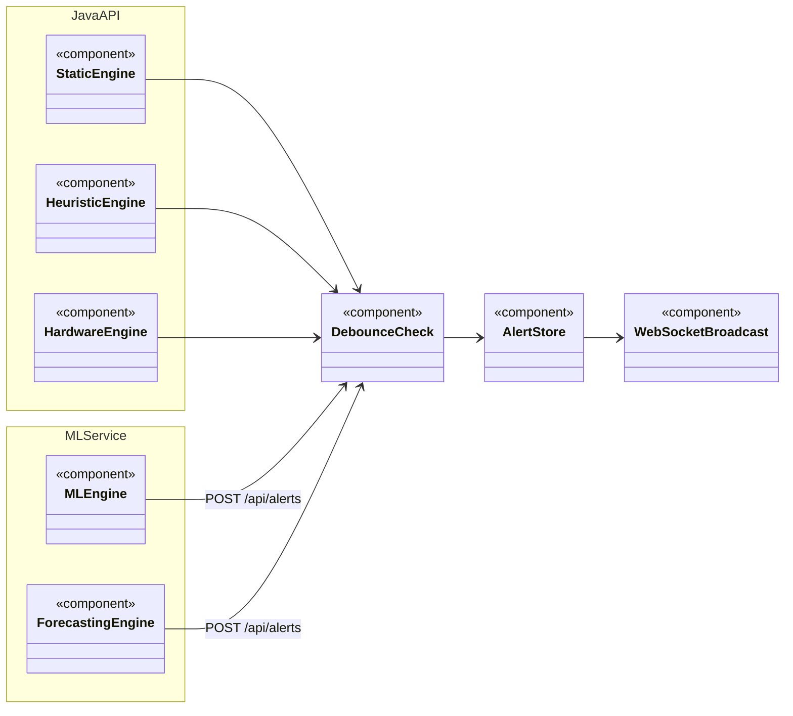
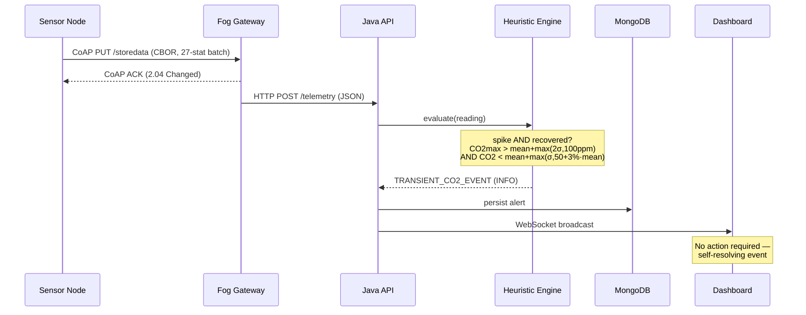
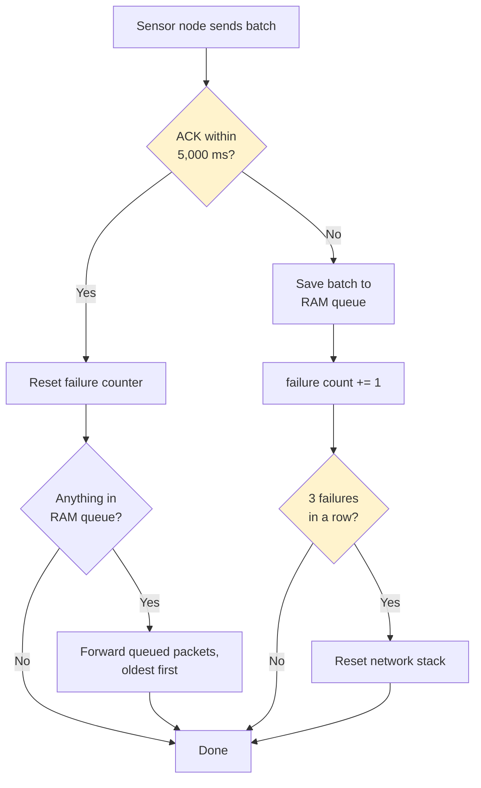
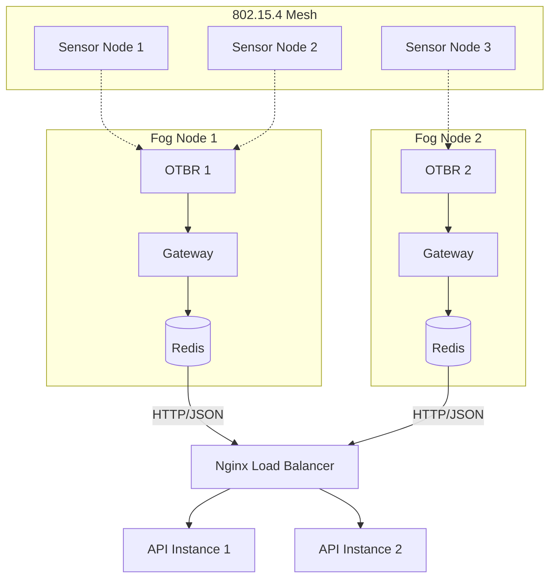

<!-- 
NOTES FOR PRESENTER:
- This deck maps 1:1 to the professor's required structure (Section 1.3):
  Application Idea -> HW Architecture -> SW Architecture (UML) -> Network Structure
  -> Tool Chain -> Results & Demo -> Reliability -> Statistics
- Target: 20-25 minutes. ~18 content slides at ~1-1.5 min/slide fits this.
- All content pulled directly from the audited ieee-report.tex (verified against
  the codebase in the same session) - no new claims introduced here.
- Sections marked "PENDING DATA" need real numbers before this is presentation-ready.
-->

# Thread-Based Intelligent Indoor
# Environmental Monitoring System

**Smart Sensor Network System (SSNS)**

M.Sc. High Integrity Systems
Frankfurt University of Applied Sciences

---

## Agenda

1. Application Idea
2. Architecture — Hardware
3. Architecture — Software (UML)
4. Architecture — Network Structure
5. Tool Chain
6. Results & Demonstration
7. Reliability
8. Statistics

---

# 1. Application Idea

---

## The Problem

- Indoor CO2, PM2.5, and VOC concentrations degrade cognitive performance and respiratory health
- Traditional monitoring: periodic manual inspection or rigid single-parameter thresholds
- Rigid thresholds → either too noisy (false alarms) or too blind (miss multi-variable, sub-threshold hazards)
- Cloud-centric IoT architectures add latency, bandwidth cost, and single points of failure

## What SSNS Does

- Real-time, multi-sensor indoor environmental monitoring over a low-power wireless mesh
- Combines **deterministic safety thresholds**, **statistical heuristics**, and **unsupervised ML anomaly detection**
- Distinguishes transient/benign events (breath, cleaning spray, hot tea) from genuine hazards (fire, gas leak, ventilation failure)
- Edge-native: fog computing tier keeps latency and bandwidth low, avoids single point of failure

---

# 2. Architecture — Hardware

---

## Sensor Node (Edge Tier)

**MCU:** Nordic Semiconductor nRF52840 dev kit
- Native IEEE 802.15.4 radio (2.4 GHz)
- Runs Zephyr RTOS

**Sensors (I2C):**
| Sensor | Measures | Poll interval |
|---|---|---|
| Sensirion SCD41 | CO2, Temperature, Humidity | 5.5 s |
| Sensirion SPS30 | PM1.0 / PM2.5 / PM4.0 / PM10 | 1.5 s |
| ScioSense CCS811 | TVOC | 1.0 s |

- Each sensor polled by an independent Zephyr thread (Producer-Consumer pattern)
- Mutex-protected shared memory → no I2C bus race conditions

---

## Fog / Gateway Tier

- Linux-based edge gateway
- OpenThread Border Router (OTBR) — bridges 802.15.4 mesh ↔ IPv4/IPv6 host network
- Redis for Store-and-Forward buffering (survives upstream outages)
- Runs on commodity hardware (not resource-constrained like the sensor node)

---

# 3. Architecture — Software (UML)

---

## System Component Diagram

*Legend: solid = direct call/connection; dashed = periodic polling (UML dependency) — the only polling relationship here is the ML Service's telemetry poll; the alert POST directly below it is a one-shot push, not polling.*

---

## Alert Engine — Component Diagram

**Sync group** (`JavaAPI` namespace) evaluates every incoming packet synchronously — Static (deterministic thresholds), Heuristic (rolling 30-sample stats), Hardware (`healthStatus` bitmask). **Async group** (`MLService` namespace) runs on an independent polling loop, decoupled from packet arrival — ML Engine (Isolation Forest), Forecasting Engine (EMA + linear regression). Both groups push into a shared 300s-suppression Debounce Check before reaching the Alert Store.

**Five engines, not four (as originally proposed):** the Heuristic Engine is the one addition. The ML engine requires a confirmation window before it can flag anything — structurally blind to events shorter than that window. The Heuristic Engine evaluates every packet instantly, closing that specific gap.

---

## Alert Engine — Sequence Diagram (example: transient CO2 spike)

*Solid arrow = synchronous call, dashed arrow = response/return (standard UML sequence notation).*

---

## Edge Node — Send / Retry / Buffer Logic

*Legend: diamond = decision point (highlighted).*

**Two details worth knowing if asked:**
- **Queue forwarding** is per-packet, not bulk: each queued packet is sent and ACKed individually, and forwarding stops early the moment one fails — not an all-or-nothing operation.
- **Queue overflow**: if the RAM queue fills up (50 packets) while offline, it overwrites the *oldest* unsent packet to make room for the newest — a circular buffer, not a hard stop.

*Verified directly against `firmware/sensor-node/src/main.c` and `storage.c`. This is exactly what the Reliability test protocol (Part B) exercises.*

---

# 4. Architecture — Network Structure

---

## Network Topology

*Legend: dashed = wireless (802.15.4 mesh link); solid = wired/HTTP.*

- **Physical/MAC layer:** IEEE 802.15.4, hardcoded Thread dataset (Channel 26, PanId 0x1235)
- **Mesh layer:** OpenThread — autonomous routing, self-healing; any sensor node can re-parent to either Border Router (dashed lines above show one example mapping, not a fixed partition), automatic parent search on link loss
- **Redundancy:** two independent fog gateways/Border Routers — eliminates the single point of failure the original proposal's single serial-tethered gateway had
- **Application layer:** CoAP (RFC 7252) over UDP — `CONFIRMABLE` PUT to `storedata`, 5,000 ms ACK timeout
- **Payload encoding:** CBOR (RFC 8949) — compact binary, 27-element statistics map per batch
- **Backend ↔ Frontend:** WebSocket (persistent, bidirectional) — avoids HTTP polling overhead

---

# 5. Tool Chain

---

## Development Tooling

| Layer | Tools |
|---|---|
| Firmware (edge) | Zephyr RTOS + nRF Connect SDK, `west` build tool, `zcbor`, C |
| Gateway (fog) | Python 3, `aiocoap`, `cbor2`, Redis client |
| Backend | Java, Spring Boot, Maven, MongoDB driver |
| ML Service | Python, scikit-learn, FastAPI, NumPy |
| Frontend | React, Vite, Material UI, Recharts, React Flow |
| Orchestration | Docker, Docker Compose (per-tier `docker-compose.yml`) |
| Networking | OpenThread stack, `ot-ctl` for mesh diagnostics |
| Version control | Git |

## Configuration Approach

- Alert thresholds externalized via Spring `@Value` + `application.yml` (no rebuild to retune)
- ML baseline warm-up window: dashboard-configurable per node
- Each tier isolated in its own Docker container — independent scaling, independent restart policies

---

# 6. Results & Demonstration

---

## Live Demo Plan

1. Show dashboard — live WebSocket telemetry stream
2. Trigger a **Static Engine** event (e.g., breach a CO2/PM2.5 threshold) → show alert + dashboard explainer dialog
3. Trigger a **Heuristic Engine** transient event (e.g., breathe on sensor) → show it self-resolves, no false static alarm
4. Show **ML Engine** anomaly detection on historical replay data
5. Show **Forecasting Engine** early-warning trend projection

## Offline ML Evaluation (2.8-day historical recording, single room)

| Metric | Result |
|---|---|
| True Positive Rate (TPR) | 77.31% |
| False Positive Rate (FPR) | 0.45% |
| False Negative Rate (FNR) | 22.69% |
| CO2 Detection Latency | 584 s (within 900 s ramp) |
| Confirmation Window | 50 consecutive readings |

*Correction history is a legitimate talking point: 7 concrete implementation bugs were found and fixed via this evaluation — the FPR target (<0.5%) is met; TPR is short of the 95% target and is documented as future work.*

---

# 7. Reliability

## ⚠️ PENDING REAL TEST RESULTS

**Test protocol defined:** `docs/final/presentation/reliability-test-protocol.md` — two parts:

**Part A — 10-run failover test** (fast, ~3-5 min/run): repeatedly kill/restore one fog node (verify mesh re-parents to the other + rejoins cleanly) and one backend API instance (verify the other instance takes over via Nginx + rejoins cleanly). Failure rate = (failed runs / 10) × 100%.

**Part B — boundary condition tests** (run once each, not counted in the 10):
- Both fog nodes down >25 min → verify the edge node's circular buffer (`storage.c`) behaves exactly as the report claims: data intact up to 25 min, only data *after* that point is lost to overwrite
- Both backend API instances down → verify fog-tier Redis caches everything and drains fully on recovery, zero permanent loss

**Why split this way:** failover timing is genuinely non-deterministic (real mesh/network behavior) — that's what repeating 10x is *for*. The 25-minute buffer is deterministic arithmetic (50 packets ÷ 30s interval) — proving the exact boundary once is a stronger, more specific claim than diluting it across 10 runs.

*Run the protocol before presenting; this slide should show the filled-in results table, not the live test.*

---

# 8. Statistics

*Statistics exist at two levels in this system: the sensor node computes rolling mean/std/max per channel on-device before every transmission (27-element CBOR map, see Network Structure/Tool Chain); the analysis below applies the same statistical rigor at the system-evaluation level, on real measured data.*

## Temperature (real historical recording, `saleems_room_node_e9b1.csv`)

| Statistic | Value |
|---|---|
| n (valid readings) | 19,300 |
| Mean | 29.80 °C |
| Std Dev | 0.95 °C |
| 95% CI on mean | [29.79, 29.82] °C |
| Range | 26.5 – 31.6 °C |

*719 rows excluded as hardware-fault sentinel values (-999), consistent with how the report's own ML evaluation filters the same dataset.*

---

## CO2 Detection Latency (real model, real data — 6 independently-injected events)

Extended the report's own evaluation methodology (same trained Isolation Forest, same dataset, same 1.3× ASHRAE 62.1 injection magnitude) to inject **6 separate CO2 hazard events** spread across the test set, instead of the single event behind the report's one aggregate number (584s).

| Event | Detection Latency |
|---|---|
| 1 | 794 s |
| 2 | 2,806 s |
| 3 | 301 s |
| 4 | 302 s |
| 5 | 2,561 s |
| 6 | **not detected within the 1h15m observation window** |

| Statistic | Value |
|---|---|
| n | 5 detected / 6 injected |
| Mean | 1,353 s |
| Std Dev | 1,234 s |
| 95% CI | wide, crosses zero — small-n artifact, not a literal claim of negative latency |

**Honest interpretation, not hidden:** latency varies substantially by conditions (301s–2,806s), and event 6 was missed even with ~2 hours of runway left in the dataset — ruling out a data-cutoff artifact. Plausible explanation: after 5 prior CO2 spikes, the model's drift-adaptation may have partially absorbed elevated CO2 as the new "normal," reducing sensitivity to the 6th. This directly reinforces two items already in this deck's Future Work: confirmation-window sizing and detection-latency characterization need more rigorous, larger-scale validation than a single historical recording can provide.

---

# Future Work

**Security & Robustness**
- Persist the edge node's RAM-only packet queue to Zephyr NVS flash — survive power loss during a partition, not just network loss
- CoAP-over-DTLS at the edge (currently unencrypted UDP, chosen for prototyping speed)
- Robust JWT validation on the frontend
- Migrate orchestration to Kubernetes — remove the reverse-proxy single point of failure
- MCUboot-based OTA firmware updates (no physical JTAG needed)

**ML Evaluation**
- Validate against a 30-day, multi-room dataset (current: 2.8 days, single room)
- Derive the confirmation window analytically per anomaly type, rather than the current empirically-tuned constant (50 readings)
- Address the ML layer's blind spot for hazards shorter than the confirmation window (~5 min at the evaluated poll rate) — currently covered only by the Heuristic Engine

---

# Conclusion

- SSNS: decoupled, multi-tier architecture — edge, fog, platform, ML, operator
- Five-engine alert architecture: deterministic safety + statistical heuristics + ML anomaly detection + forecasting + hardware health
- Redundant mesh networking eliminates the single point of failure flagged in proposal review
- ML evaluation: FPR target met (0.45% < 0.5%); TPR and multi-room validation flagged as future work
- **Open before this is presentation-ready:** Reliability (10-run data) and Statistics (real measured-value stats) sections need real numbers

# Questions?
