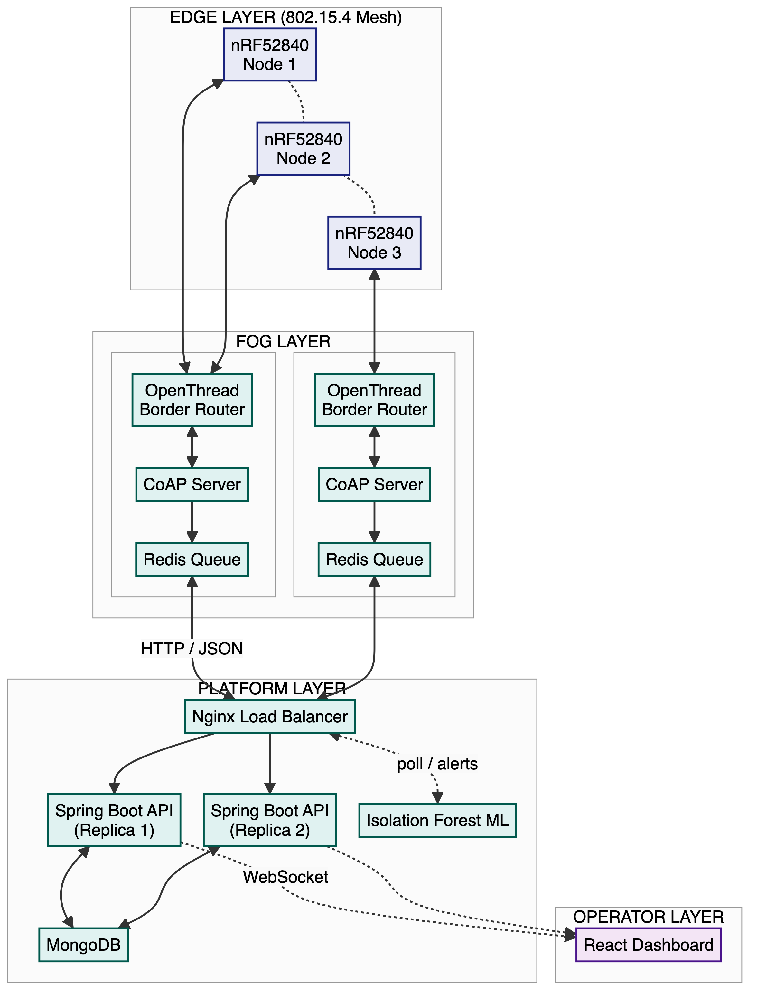
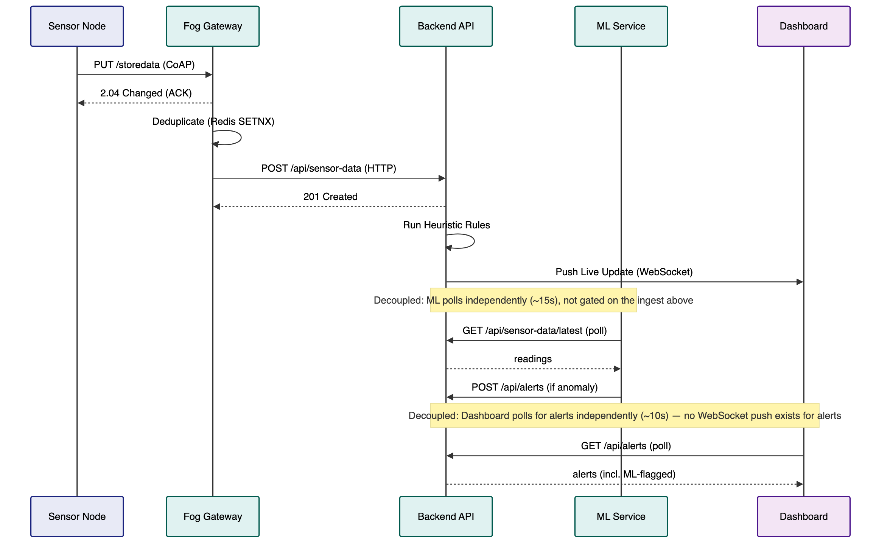
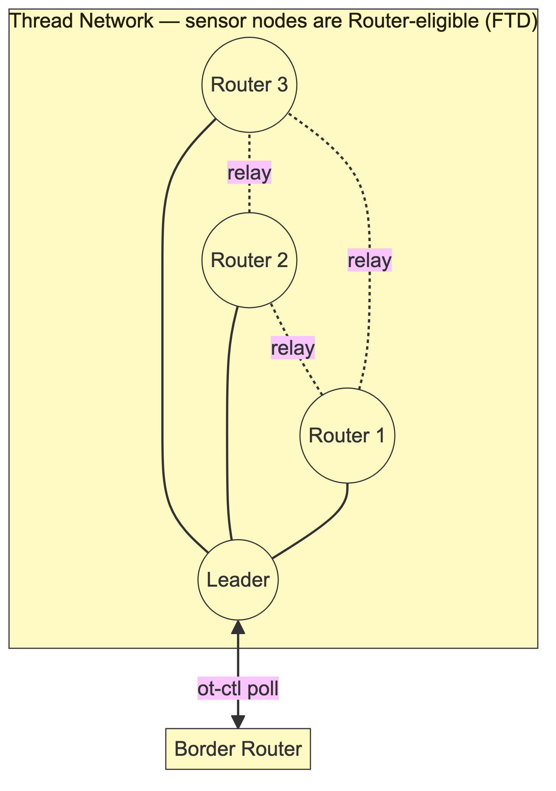
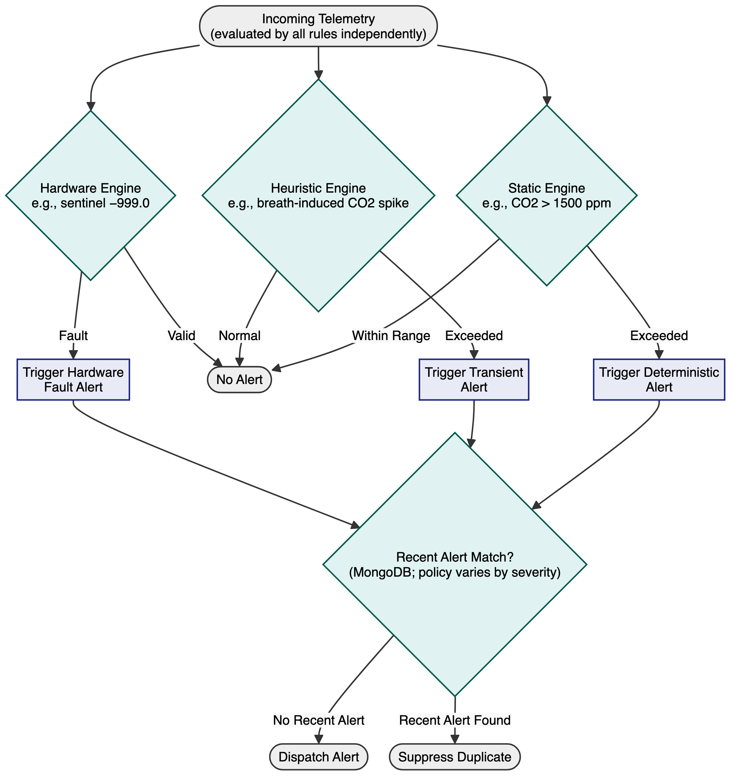
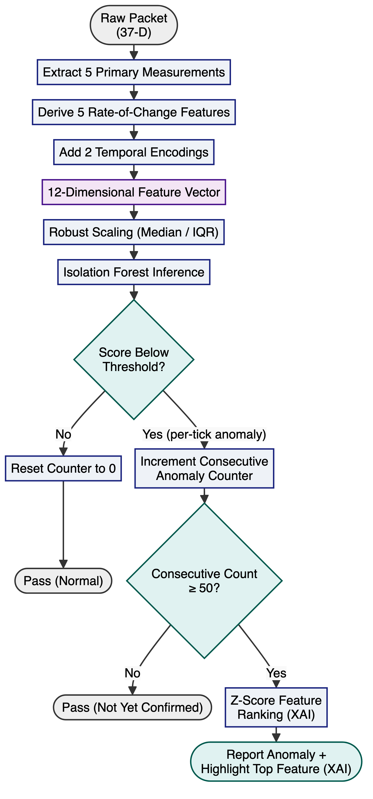
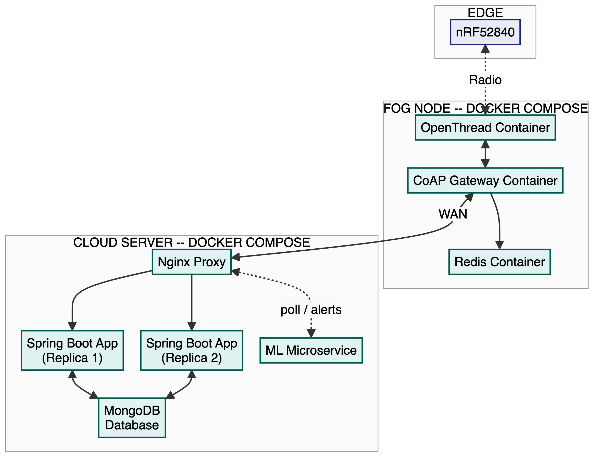
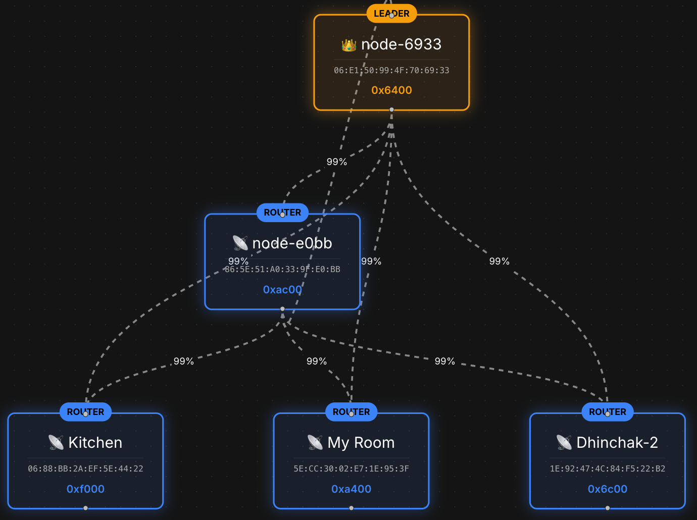

# Thread-Based Intelligent Indoor Environmental Monitoring System

**Author** (M.Sc. High Integrity Systems, Frankfurt University of Applied Sciences, Frankfurt, Germany):  
Muhammad Saleem (muhammad.saleem2@stud.fra-uas.de)

## Abstract
The rapid deployment of Internet of Things (IoT) platforms in indoor environments requires highly scalable, reliable, and intelligent systems. This report details the complete implementation of the Thread-Based Intelligent Indoor Environmental Monitoring System, henceforth referred to as the Smart Sensor Network System (SSNS), a multi-tier platform designed for real-time environmental monitoring. The proposed architecture integrates IEEE 802.15.4 OpenThread mesh networks, fog computing, and a decoupled cloud backend to process high-frequency telemetry. The system employs a multi-engine alert architecture combining deterministic safety thresholds, dynamic statistical heuristics, and an advanced Machine Learning (ML) pipeline based on Isolation Forests. This document presents the hardware constraints, software implementation, mathematical models, and architectural decisions informed by ASHRAE [[1]](#references), [[2]](#references), OSHA [[3]](#references), WHO [[4]](#references), EPA [[5]](#references), and WELL [[6]](#references) guidelines.

## Table of Contents
1. Introduction and Motivation
2. Hardware and Software Components
3. System Architecture
4. System Implementation
5. Experimental Setup and Evaluation
6. Conclusion
References
Appendix
Glossary

## List of Figures
- Figure 1 – Overall architecture
- Figure 2 – OpenThread mesh topology (sensor nodes are Router-eligible/FTD)
- Figure 3 – Communication workflow
- Figure 4 – Alert workflow
- Figure 5 – Machine-learning pipeline
- Figure 6 – Deployment architecture
- Figure 7 – Live network self-organization (dashboard capture)

## List of Tables
- Table 1 - Environmental Thresholds
- Table 2 - ML Anomaly Detector and Forecasting Engine Evaluation Results

---

## 1. Introduction and Motivation

### 1.1 Indoor environmental monitoring
Indoor environmental quality profoundly impacts human health, cognitive performance, and operational efficiency. Prolonged exposure to high concentrations of carbon dioxide (CO2), particulate matter (PM2.5), and volatile organic compounds (VOCs) presents acute health risks and degrades overall building safety.

### 1.2 Life-safety motivation
The primary motivation for the SSNS project is to protect life-safety by distinguishing between transient anomalies (e.g., breath or cleaning aerosols) and genuine hazards (e.g., fires or gas leaks). The proposed system employs rigorous mathematical correlation to eliminate false positives and ensure actionable intelligence.

### 1.3 Limitations of cloud-centric IoT systems
Traditional cloud-centric IoT architectures suffer from inherent latency, single points of failure, and excessive bandwidth consumption when processing high-frequency telemetry. These limitations necessitate pushing computation toward the network edge.

### 1.4 Fog computing
The proposed architecture implements a fog computing tier to bridge the constrained edge devices and the centralized backend. The fog layer provides local buffering, deduplication, protocol translation, and high-availability queueing, ensuring fault tolerance during network partitions.

### 1.5 OpenThread mesh networking
To ensure reliable communication in physically obstructed indoor environments, the system utilizes an IPv6-based OpenThread mesh network operating on the IEEE 802.15.4 standard [[7]](#references). The mesh enables autonomous routing and self-healing connectivity.

### 1.6 Project objectives
The core objectives of the SSNS include establishing a scalable microservice architecture, developing a robust multi-engine alerting system compliant with global safety standards, and integrating explainable machine learning models for predictive forecasting.

### 1.7 Related work
Related work informed key design choices. Ortega et al. [[8]](#references) show Isolation Forest can be made 79x/166x more efficient without accuracy loss, reinforcing its choice as a lightweight, unsupervised algorithm for this project's decoupled ML service; Wu et al. [[9]](#references) survey GNN-based IIoT anomaly detection, an approach avoided here given its overhead for a single-room deployment; Guha and Datta [[10]](#references) show that a fixed sliding window is suboptimal for IIoT drift-adaptation, reinforcing this project's own move away from a static window toward the statistically-triggered recalibration evaluated in Section 6.6; Khattak et al. [[11]](#references) validate IEEE 802.15.4-based Thread mesh networking, supporting the OpenThread architecture used here. Localized, edge-native systems combining these elements remain limited, motivating this project's integrated design.

---

## 2. Hardware and Software Components

### 2.1 Hardware platform
The edge nodes are built upon the Nordic Semiconductor nRF52840 development kit. This microcontroller provides native IEEE 802.15.4 radio support, executing the Zephyr Real-Time Operating System (RTOS) [[12]](#references) while adhering to strict low-power constraints.

### 2.2 Sensor components
The edge nodes interface with multiple high-precision I2C sensors:
- **SCD41**: Monitors CO2 concentration.
- **SPS30**: Measures particulate matter (PM1.0, PM2.5, PM4.0, PM10).
- **CCS811**: Detects Total Volatile Organic Compounds (TVOC).

### 2.3 Communication protocols
The constrained edge nodes transmit telemetry utilizing the Constrained Application Protocol (CoAP) [[13]](#references) over UDP/IPv6. Payloads are aggressively compressed using Concise Binary Object Representation (CBOR) [[14]](#references). The fog layer translates these packets into standard HTTP JSON POST requests.

### 2.4 Backend technologies
The core platform is implemented as a stateless Java Spring Boot application exposing REST APIs. A MongoDB NoSQL database manages highly denormalized telemetry data, while WebSockets facilitate low-latency broadcasting. Nginx provides Layer 7 load balancing.

### 2.5 Frontend technologies
The operator dashboard is a Single Page Application (SPA) developed with React and Vite. It utilizes Material UI for responsive design, Recharts for time-series visualization, and React Flow for dynamic topology mapping.

### 2.6 Monitoring infrastructure
The application relies on Docker's stdout/stderr logging, Spring Boot Actuator endpoints, and custom background scheduling jobs to evaluate network health and node timeouts autonomously.

### 2.7 Development environment
The entire ecosystem relies heavily on Docker and Docker Compose for orchestration. The deployment isolates dependencies across independent containers utilizing host and bridge networking.

---

## 3. System Architecture

### 3.1 Overall architecture
The SSNS architecture represents a highly decoupled, multi-tier distributed system comprising edge nodes, fog gateways, backend ingestion services, document-oriented databases, and isolated machine-learning pipelines.

### 3.2 Sensor layer
The sensor layer operates as a highly concurrent **Producer-Consumer** architecture. Given the strict timing requirements of the physical I2C sensors (SCD41, SPS30, CCS811), a single-threaded polling loop would introduce unacceptable latency and jitter. Instead, the sensors act as independent producers, polled asynchronously by dedicated Zephyr RTOS threads executing at hardware-specific intervals (e.g., 5.5s for CO2, 1.0s for TVOC). These producer threads calculate local statistics (Mean, Max, Standard Deviation) and write the aggregated payloads into a shared memory space. A centralized network thread acts as the consumer, safely extracting this data utilizing Mutex locks to enforce thread safety and eliminate race conditions on the I2C bus. This decoupled architecture entirely prevents main-loop blocking, ensuring deterministic execution even under heavy sensor load.

### 3.3 Fog layer
The fog layer implements a **Store-and-Forward** architectural pattern to ensure absolute fault tolerance across unstable wide-area networks. Operating as a Linux-based edge-gateway, it terminates the constrained 802.15.4 radio mesh via an OpenThread Border Router (OTBR). To prevent data corruption from concurrent mesh transmissions, incoming CoAP UDP datagrams are strictly deduplicated using distributed Redis `SETNX` locks evaluated against unique message IDs. Once validated, the payloads are pushed to a Redis `LPUSH` queue. If the upstream cloud connection drops, an exponential backoff algorithm caches the JSON payloads locally in Redis, ensuring zero data loss and forwarding them only when HTTP TCP connectivity is restored.

### 3.4 Platform layer
The backend tier is designed around a highly scalable **Event-Driven Publisher-Subscriber** model. A stateless Java Spring Boot API acts as the central ingestion broker. By remaining entirely stateless, the backend can be horizontally scaled (two redundant replicas in the current deployment) behind an Nginx Layer 7 Load Balancer to handle thousands of concurrent edge nodes. Upon ingestion, the API executes synchronous multi-engine alert heuristics in memory. Validated telemetry is asynchronously persisted to a highly denormalized MongoDB NoSQL database, optimized with compound indexes for rapid time-series queries. Simultaneously, the payload is published to an active WebSocket topic, enabling zero-latency broadcasting to connected clients without the overhead of HTTP polling.

### 3.5 Operator layer
The presentation tier operates as a **Reactive Single Page Application (SPA)** constructed with React and Vite. Serving as a real-time Network Operations Center (NOC) dashboard, it maintains a persistent, bidirectional WebSocket subscription to the backend. Because environmental sensors can emit thousands of data points per hour, rendering the entire dataset would cause catastrophic browser DOM memory exhaustion and UI freezing. To mitigate this, the client implements a bounded sliding-window state manager (maximum 10,000 records) coupled with React Flow for dynamic SVG topology mapping. This ensures that administrators can visualize complex OpenThread routing paths and investigate anomalies with 60 FPS rendering performance.

### 3.6 Data flow
Telemetry follows a synchronous ingest pipeline: Sensor acquisition (I2C) → OpenThread (CoAP/CBOR) → Fog Gateway (HTTP/JSON) → Nginx Load Balancer → Java API → MongoDB → WebSocket → React UI. The ML service is decoupled from this path: it polls the API on its own ~15-second interval (Section 5.9) rather than sitting inline before the WebSocket push.

---

## 4. Mesh Networking and OpenThread Infrastructure

### 4.1 IEEE 802.15.4 Physical Layer
To ensure reliable communication in physically obstructed indoor environments, the system utilizes an IPv6-based mesh network operating on the constrained IEEE 802.15.4 radio standard. The low-power radio allows the sensor nodes to operate continuously without thermal interference to the highly sensitive ambient sensors.

### 4.2 OpenThread Routing Topology
Sensor node firmware deliberately omits `CONFIG_OPENTHREAD_MTD`, keeping every node Router-eligible (a Full Thread Device) so sensors can relay packets for each other and form a genuine multi-hop mesh rather than a single-hop star. Communication utilizes a hardcoded Thread dataset (Channel 26, PanId 0x1235). The OpenThread stack dynamically routes packets and initiates autonomous parent searches upon connection loss.

### 4.3 Constrained Application Protocol (CoAP)
The Constrained Application Protocol (CoAP) is executed over UDP. Edge nodes send PUT requests to the URI `storedata` and block for up to 5,000 ms awaiting an explicit CoAP ACK.

### 4.4 OpenThread Border Router (OTBR)
The OpenThread Border Router bridges the IEEE 802.15.4 radio network to the IPv4/IPv6 host network. The system polls `ot-ctl` to monitor routing topologies and child tables.

## 5. System Implementation

### 5.1 Sensor acquisition
The embedded firmware implements a Dual-Mode Abstraction (Hardware and Simulation). In hardware mode, the Zephyr RTOS spawns dedicated background threads to poll the SCD41 (5.5s), CCS811 (1.0s), and SPS30 (1.5s). Data is aggregated using a mutually exclusive lock (Mutex).

### 5.2 Sensor scheduling
The firmware executes a 60-second silent warm-up phase to populate internal caches. It samples the sensors every 6 seconds and transmits statistics over the network every 30 seconds to minimize RF overhead.

### 5.3 CBOR encoding
Payloads are serialized using the `zcbor` library. A single batch contains raw sample arrays and a 27-element statistics map capturing the Mean, Standard Deviation, and Maximum values computed natively on the node using a two-pass algorithm.

### 5.4 Gateway implementation
The Python gateway runs an asynchronous CoAP server (`aiocoap`). It decodes CBOR, deduplicates payloads via Redis `SETNX` commands with a 300-second TTL, and anchors relative uptimes against UTC timestamps.

### 5.5 Redis buffering
The fog tier utilizes Redis as a high-availability Store-and-Forward queue (`LPUSH`/`LPOP`). Failed HTTP transmissions invoke an exponential backoff retry mechanism.

### 5.6 Database persistence
The system employs MongoDB for persistence. The `SensorData` documents are heavily denormalized. A unique compound index on `nodeId`, `bootId`, and `sequenceNumber` enforces telemetry deduplication, while single-field indexes on `nodeId` and `timestamp` optimize read throughput for time-series charts.

### 5.7 Threshold Justification and Standards
The deterministic safety thresholds are informed by global environmental and public health guidelines. The parameters were selected to monitor acute toxicity, respiratory safety, and thermal comfort.

| Parameter | Safety Threshold | Source Standard | Justification |
| :--- | :--- | :--- | :--- |
| **Carbon Dioxide (CO2)** | > 1500 ppm | ASHRAE Position Doc. on Indoor CO2 [2] | Upper end of the ~1000–1500 ppm ISIAQ-compiled international CO2 guideline range; elevated CO₂ reduces cognitive performance and indoor air quality. |
| **Particulate Matter (PM2.5)** | > 35 µg/m³ | U.S. EPA [5] | EPA NAAQS 24-hour primary standard for fine inhalable particulates. |
| **Total VOCs (TVOC)** | > 1000 ppb | WELL v2 [6] | Conservative ppb-scale threshold, set above WELL v2's continuous-monitoring concern level (500 µg/m³). |
| **Temperature** | < 10°C or > 35°C | ASHRAE 55 [1] | Project-specific life-safety bounds beyond the ASHRAE 55 comfort zone (typically 20–26°C). |
| **Humidity** | < 20% or > 60% RH | OSHA [3] | OSHA Technical Manual indoor humidity control range (20–60% RH), consistent with EPA mould-prevention guidance (below 60%). |

*(Table 1 - Environmental Thresholds)*

### 5.8 Alert engine
The Java backend features a multi-engine architecture processing deterministic and heuristic rules independently and in parallel on every packet. With the Machine-Learning Engine (Section 5.9) and Forecasting Engine (Section 5.10), this forms a five-engine alert architecture; the Heuristic Engine is the one addition beyond a deterministic-safety / behavioral-anomaly / early-warning / infrastructure split, closing the Machine-Learning Engine's structural blind spot for short-lived, sub-confirmation-window events (e.g., a window opening or a cleaning spray) by evaluating every packet instantly, with no confirmation delay.
- **Static Engine**: Enforces explicit public health thresholds. It triggers alerts when Carbon Dioxide exceeds 1500 ppm (ASHRAE Position Document on Indoor CO2 [[2]](#references)), Particulate Matter (PM2.5) exceeds 35 µg/m³ (U.S. EPA [[5]](#references)), TVOC exceeds 1000 ppb (WELL v2 [[6]](#references)), Temperature breaches the 10°C to 35°C life-safety bounds (ASHRAE 55 [[1]](#references)), or Humidity breaches the 20% to 60% RH bounds (OSHA [[3]](#references)).
- **Heuristic Engine**: Isolates transient and sustained events using rolling 30-sample statistics clamped by sensor-specific noise floors: SCD41 accuracy [[15]](#references) of ±0.8°C (15–35°C) and ±(50 ppm + 3%); SPS30 precision [[16]](#references) of ±5 µg/m³; and a CCS811 TVOC floor of ±25 ppb, a project-selected margin since its datasheet [[17]](#references) publishes no TVOC accuracy spec. Transient VOC bursts are identified when $ \text{VOC}_{max} > \text{VOC}_{mean} + \max(1.5 \times \text{VOC}_{std}, 25) $, and a fusion rule flags cleaning events when TVOC and PM2.5 register simultaneous 3-sigma spikes.
- **Hardware Engine**: Evaluates 8-bit `healthStatus` masks and detects placeholder sentinel values (-999.0).
- **Distributed Debouncing**: To prevent cascading alert storms during sustained anomalies, the backend queries the shared MongoDB store for the most recent alert of the same node and type. Once an INFO-level alert triggers, it enforces a strict 300-second suppression window per node and alert type; non-INFO alerts are deduplicated by checking for an existing unresolved alert of the same type.

### 5.9 Machine-learning pipeline
The ML service operates autonomously via asynchronous polling. The sensor nodes generate a 37-dimensional feature vector consisting of ten raw measurements and twenty-seven statistical aggregations. The machine-learning service receives the complete packet but selects five primary measurements and derives five rate-of-change features and two temporal encodings, producing a 12-dimensional feature vector for the Isolation Forest model.

The core inference engine utilizes Scikit-Learn's Isolation Forest algorithm [[18]](#references). The contamination parameter is configured to `"auto"`, applying a fixed decision threshold derived from the original Isolation Forest paper rather than requiring a manually specified outlier fraction. Features are normalized using robust scaling to resist transient outlier corruption. Explainable AI (XAI) feature attribution is achieved using absolute Z-score ranking.

The baseline warm-up window is dashboard-configurable per node rather than fixed, allowing operators to trade off calibration time against deployment speed: a short window enables rapid activation when redeploying a node to a new room under time pressure, while a longer window permits more thorough calibration for permanent installations.

### 5.10 Forecasting engine
The forecaster utilizes a 60-sample sliding deque smoothed via an Exponential Moving Average. Linear regression projections are gated; forecasting aborts if the R-Squared correlation coefficient drops below 0.65.

### 5.11 Self-healing logic
The system employs three independent, layer-specific self-healing mechanisms:
- **Edge Buffering**: The edge node buffers up to 50 packets in a RAM queue to survive 25-minute network partitions.
- **ML Imputation**: The ML service imputes dead sensor channels via a duration-tiered scheme: Last-Observation-Carried-Forward under 5 minutes, damped median-decay from 5-60 minutes, full median masking beyond 60 minutes.
- **Alert Debouncing**: The backend initiates a 300-second distributed debounce to suppress identical duplicate alerts.

### 5.12 Dashboard implementation and real-time operations
The operator dashboard is a Single Page Application constructed with React, Vite, and Material UI. It consumes high-frequency telemetry via WebSockets, storing a maximum sliding window of 10,000 records locally to prevent browser DOM memory exhaustion. Dynamic topological maps are rendered using React Flow to visualize multi-hop OpenThread routing paths at 60 FPS.

### 5.13 Historical topology scrubber and temporal state playback
To observe and empirically validate OpenThread's autonomous mesh restructuring, self-healing, and dynamic role migrations over time, the platform incorporates a temporal topology auditing subsystem:
- **Historical Snapshot Persistence**: The Spring Boot backend periodically captures the multi-node graph into a dedicated `NetworkTopologyHistory` MongoDB document collection. Each snapshot records active Border Router metadata, node hardware extended addresses, operational roles (`LEADER`, `ROUTER`, `CHILD`, `DETACHED`), link quality metrics, route path costs, and gateway connectivity states.
- **Differential Event Markers**: The dashboard features an interactive `TopologyScrubber` timeline component with automated frame-by-frame event recognition. It compares consecutive topological states to highlight key events:
  - 🔴 **Gateway Outages (Red Marker)**: Detects state transitions between `ONLINE` and `OFFLINE` at the edge fog gateway.
  - 🟠 **Leader Election (Orange Marker)**: Flags shifts in the designated Thread mesh Leader, identifying dynamic network partitions and reconciliations.
  - 🟢/⚪ **Node Lifecycle (Green/Grey Marker)**: Tracks nodes joining or ungracefully departing the 802.15.4 radio cluster.
  - 🟣 **Self-Healing Role Promotions (Purple Marker)**: Visualizes autonomous OpenThread role transformations (e.g., `Child` $\rightarrow$ `Router` when routing redundancy degrades, or `Router` $\rightarrow$ `Child` during topology optimization).
- **Dynamic Playback Visualization**: Coupled with React Flow, the UI provides fluid play, pause, and step-through scrubbing. Graph nodes dynamically indicate active leader status via rhythmic pulsing animations, color-code link qualities according to empirical signal budgets, and dynamically reposition without DOM thrashing or transient edge crashes.

---

## 6. Theoretical Performance and Evaluation Methodology

### 6.1 Mathematical Formulations
To ensure robust analytical rigor, the system centralizes its core mathematical logic:
- **Standard Deviation**: Computed natively on the edge nodes using a two-pass algorithm: $ \sigma = \sqrt{\frac{\sum(x - \mu)^2}{n}} $
- **Exponential Moving Average (EMA)**: Utilized by the forecasting engine to smooth time-series data: $ \text{EMA}_t = 0.25 \times X_t + 0.75 \times \text{EMA}_{t-1} $
- **Z-Score**: Used for Explainable AI (XAI) feature attribution by calculating the absolute standard score.
- **Exponential Backoff**: Implemented in the fog layer queue to prevent network flooding: $ \text{Delay} = \min(3600, 2^{\text{retry}}) $
- **Robust Scaling**: Applied during machine learning preprocessing to resist transient outlier corruption: $ \text{Scaled} = \frac{X - \text{Median}}{\max(\text{IQR}, 1e-9)} $
- **Linear Regression**: Evaluated for trend projection; forecasting aborts if the R-Squared coefficient drops below $0.65$.
- **Decay Function**: The damped-decay tier of the ML imputation scheme (Section 5.11) blends the last valid reading toward the channel median: $ \text{Decay} = e^{-0.000385 \times t} $

### 6.2 Deployment methodology
The proposed deployment architecture was experimentally validated using Docker Compose orchestration over isolated IPv4 bridge networks to accurately simulate production edge-to-cloud topologies.

### 6.3 Fault-tolerance constraints
The system imposes strict guarantees on offline survivability: the 50-packet edge RAM queue, at a fixed 30-second transmission interval, guarantees exactly 25 minutes of data preservation during a partition, while the 5,000 ms CoAP UDP timeout bounds the latency impact of deep partitions.

### 6.4 Statistical filtering and heuristic constraints
Transient noise is distinguished from sustained hazards by combining edge-computed statistical summaries (Section 5.1) with the rolling 30-sample, noise-floor-clamped evaluation and multi-sensor fusion detailed in the Heuristic Engine (Section 5.8); clamping variance multipliers to hardware noise floors eliminates false positives in low-variance environments (e.g., empty rooms).

### 6.5 Model adaptability
The ML architecture uses a 12-dimensional Isolation Forest. Paired with a Kolmogorov-Smirnov drift detector (0.25 threshold), it autonomously rescales median/IQR normalization bounds when the environment shifts, leaving the original trees untouched -- refitting the full ensemble on drift-sized buffers destabilized the false-positive rate regardless of buffer size (Section 6.6).

### 6.6 Empirical evaluation results
An offline evaluation used a 2.8-day historical recording from a single deployed sensor node: the first 24 hours established the Isolation Forest baseline, and the remaining ~48 hours served as the streaming test set. Synthetic hazard events were injected at 30% above the ASHRAE-documented indoor CO2 guideline [[2]](#references) and the project's WELL v2-informed TVOC threshold [[6]](#references), ensuring injected anomalies represent genuine safety breaches, not ordinary room variability.

This evaluation exposed and corrected several drift-adaptation issues: an oversized retraining window, an unstable scaling floor for near-constant rate-of-change features, and contamination of the retraining reference window by the anomaly it targeted. With these fixes plus a consecutive-reading confirmation requirement (an anomaly reports only after 50 consecutive out-of-distribution readings, filtering transient noise from sustained hazards), the corrected pipeline achieved the results in Table 2.

| Metric | Result |
| :--- | :--- |
| True Positive Rate (TPR) | 77.31% |
| False Positive Rate (FPR) | 0.45% |
| False Negative Rate (FNR) | 22.69% |
| CO2 Detection Latency | 584 s (within 900 s ramp) |
| Test Dataset Span | 2.8 days, single room |
| Confirmation Window | 50 consecutive readings |
| Forecasting MAE (CO2, 30-min horizon) | 1,664.5 ppm |
| Forecasting RMSE (CO2, 30-min horizon) | 1,776.5 ppm |

*(Table 2 - ML Anomaly Detector and Forecasting Engine Evaluation Results)*

Because the confirmation requirement imposes a minimum sustained duration, brief sub-five-minute events fall outside this layer's detection horizon; the deterministic Heuristic Engine (Section 5.8) independently covers these, evaluating raw threshold breaches on each packet with no confirmation delay. This division is intentional: fixed thresholds need no historical data and cannot be destabilized by drift, but are blind to sub-threshold, multi-variable patterns only anomalous in combination -- exactly what the ML layer targets, at the cost of learning (and re-learning) what "normal" means for that room.

Using the same injected event, the Forecasting Engine's 30-minute-horizon projection was separately evaluated (Table 2). The error is large relative to the hazard threshold: a linear trend model designed for gradual drift is poorly matched to an abrupt 15-minute step-ramp. Rapid-onset events remain the Static/Heuristic/ML engines' responsibility (Section 5.8); this is reported honestly and flagged for future evaluation (Section 6.8).

These results carry the scale and confirmation-window caveats in Section 6.8. A sensitivity check against a much larger recalibration window (6,534 samples, the full training baseline) confirmed the smaller window's advantage: performance degraded on both axes (TPR 5.86%, FPR 2.44%), since a several-hundred-sample anomaly barely perturbs the Kolmogorov-Smirnov statistic over such a large window, keeping the model frozen near its initial calibration -- a measured design choice, not an arbitrary simplification.

### 6.7 Live network self-organization
Fig. 7's edges reflect each Border Router's own `ot-ctl` observations, not a verified spanning tree. During the same testing session, a genuine network partition was also observed: the two Border Routers temporarily lost mutual radio visibility and each independently self-elected as Leader of its own partition; once visibility was restored, the mesh reconciled to a single Leader without manual intervention, empirically evidencing the self-healing connectivity claimed in Section 1.5. This dynamic recovery was audited and confirmed post-hoc using the Historical Topology Scrubber (Section 5.13), which registered the transient partition via an orange leader-change marker and visualized the subsequent role realignment without packet loss.

### 6.8 Security considerations and future work
The architecture has known limitations in security, power loss, and ML validation scale: the edge node's 50-packet queue is volatile RAM only, telemetry is unencrypted UDP, and the empirical evaluation (Section 6.6) surfaces further ML validation gaps. Future work targets:

- **Persistence**: Migrate the RAM-only packet queue to Zephyr NVS Flash, preventing data loss on power failure during a partition.
- **Transport/Auth Security**: Enforce CoAP-over-DTLS instead of unencrypted UDP, and implement robust JWT validation on the frontend.
- **Orchestration**: Migrate to Kubernetes to remove the reverse-proxy single point of failure.
- **Firmware Updates**: Integrate MCUboot for OTA firmware upgrades via SMP, removing the need for physical JTAG.
- **ML Evaluation Scale**: Validate against a 30-day, multi-room dataset rather than the 2.8-day, single-room recording used here.
- **Confirmation Window**: Derive the window analytically per anomaly type instead of the tuned constant (50 readings) used here, closing the blind spot for hazards shorter than ~5 min.
- **Forecaster Evaluation**: Validate the Forecasting Engine against gradual trends rather than the abrupt step-ramp used in Section 6.6.

---

## 7. Conclusion
The Smart Sensor Network System provides a robust, decoupled architecture capable of translating raw physical telemetry into actionable life-safety intelligence. By fusing low-power Thread networking, fog computing, statistical heuristics, and unsupervised machine learning, the platform achieves high reliability while effectively eliminating transient false positives. The explicit alignment with WHO, EPA, ASHRAE, OSHA, and WELL guidelines supports empirical safety compliance.

---

## References

[1] ANSI/ASHRAE Standard 55-2023, "Thermal Environmental Conditions for Human Occupancy."
[2] ASHRAE, "Position Document on Indoor Carbon Dioxide," Approved by the ASHRAE Board of Directors, Feb. 12, 2025. Available: [https://www.ashrae.org/file%20library/about/position%20documents/pd-on-indoor-carbon-dioxide-english.pdf](https://www.ashrae.org/file%20library/about/position%20documents/pd-on-indoor-carbon-dioxide-english.pdf)
[3] U.S. Department of Labor, Occupational Safety and Health Administration, "OSHA Technical Manual (OTM), Section III: Chapter 2 — Indoor Air Quality Investigation." Available: [https://www.osha.gov/otm/section-3-health-hazards/chapter-2](https://www.osha.gov/otm/section-3-health-hazards/chapter-2)
[4] World Health Organization, "WHO Global Air Quality Guidelines," 2021.
[5] U.S. Environmental Protection Agency, "National Ambient Air Quality Standards (NAAQS) Table." Available: [https://www.epa.gov/criteria-air-pollutants/naaqs-table](https://www.epa.gov/criteria-air-pollutants/naaqs-table)
[6] International WELL Building Institute, "WELL Building Standard v2," 2020.
[7] IEEE Std 802.15.4-2020, "IEEE Standard for Low-Rate Wireless Networks." Available: [https://standards.ieee.org/ieee/802.15.4/7029/](https://standards.ieee.org/ieee/802.15.4/7029/)
[8] E. Ortega, F. Su, R. Chattopadhyay, and K. Chakrabarty, "Discretized-Isolation Forest: Memory- and Compute-Efficient Unsupervised Anomaly Detection for Resource-Constrained Internet of Things Edge Devices," IEEE Internet of Things Journal, vol. 12, no. 2, pp. 1699–1717, 2025.
[9] Y. Wu, H.-N. Dai, and H. Tang, "Graph Neural Networks for Anomaly Detection in Industrial Internet of Things," IEEE Internet of Things Journal, vol. 9, no. 12, pp. 9214–9231, 2022.
[10] S. Guha and A. Datta, "GDRNet: A Deep Learning Framework for Dynamic Sliding Window Determination and Improved Prediction Accuracy in Online IIoT Systems," IEEE Access, vol. 13, pp. 200382–200393, 2025.
[11] S. B. A. Khattak, M. M. Nasralla, H. Farman, and N. Choudhury, "Performance Evaluation of an IEEE 802.15.4-Based Thread Network for Efficient Internet of Things Communications in Smart Cities," Applied Sciences (MDPI), vol. 13, no. 13, art. 7745, 2023.
[12] Zephyr Project, "Zephyr RTOS API Reference." Available: [https://docs.zephyrproject.org/latest/doxygen/html/index.html](https://docs.zephyrproject.org/latest/doxygen/html/index.html)
[13] Z. Shelby, K. Hartke, and C. Bormann, "The Constrained Application Protocol (CoAP)," RFC 7252, 2014. Available: [https://datatracker.ietf.org/doc/html/rfc7252](https://datatracker.ietf.org/doc/html/rfc7252)
[14] C. Bormann and P. Hoffman, "Concise Binary Object Representation (CBOR)," RFC 8949, 2020. Available: [https://datatracker.ietf.org/doc/html/rfc8949](https://datatracker.ietf.org/doc/html/rfc8949)
[15] Sensirion AG, "SCD4x CO2 Sensor Datasheet." Available: [Sensirion SCD4x PDF](https://sensirion.com/media/documents/48C4B7FB/67FE0194/CD_DS_SCD4x_Datasheet_D1.pdf)
[16] Sensirion AG, "SPS30 Particulate Matter Sensor Datasheet." Available: [Sensirion SPS30 PDF](https://sensirion.com/media/documents/8600FF88/64A3B8D6/Sensirion_PM_Sensors_Datasheet_SPS30.pdf)
[17] ScioSense (formerly ams), "CCS811 Ultra-Low Power Digital Gas Sensor Datasheet." Available: [CCS811 PDF](https://cdn.sparkfun.com/assets/2/c/c/6/5/CN04-2019_attachment_CCS811_Datasheet_v1-06.pdf)
[18] Scikit-Learn Developers, "sklearn.ensemble.IsolationForest Documentation." Available: [Scikit-Learn API](https://scikit-learn.org/stable/modules/generated/sklearn.ensemble.IsolationForest.html)

---

## Appendix
A. Environmental Noise Floors
- SCD41 (Temperature): ±0.8°C, per Sensirion SCD4x datasheet typical accuracy, 15–35°C [15]
- SCD41 (CO2): ±(50 ppm + 3% of reading), per Sensirion SCD4x datasheet typical accuracy, 1001–2000 ppm [15]
- CCS811 (TVOC): ±25 ppb, project-selected margin (no TVOC accuracy spec published in [17])
- SPS30 (PM2.5): ±5 µg/m³, per Sensirion SPS30 datasheet mass-concentration precision, 0–100 µg/m³ [16]

## Glossary
- **CBOR**: Concise Binary Object Representation
- **CoAP**: Constrained Application Protocol
- **DTLS**: Datagram Transport Layer Security
- **EMA**: Exponential Moving Average
- **FTD**: Full Thread Device (Router-eligible)
- **GNN**: Graph Neural Network
- **IIoT**: Industrial Internet of Things
- **IPv4/IPv6**: Internet Protocol versions 4 and 6
- **IQR**: Interquartile Range
- **JTAG**: Joint Test Action Group (hardware debug interface)
- **LOCF**: Last-Observation-Carried-Forward
- **MTD**: Minimal Thread Device (child-only, non-relaying)
- **NVS**: Non-Volatile Storage
- **OTBR**: OpenThread Border Router
- **SMP**: Simple Management Protocol (MCUboot's update transport)
- **XAI**: Explainable Artificial Intelligence
