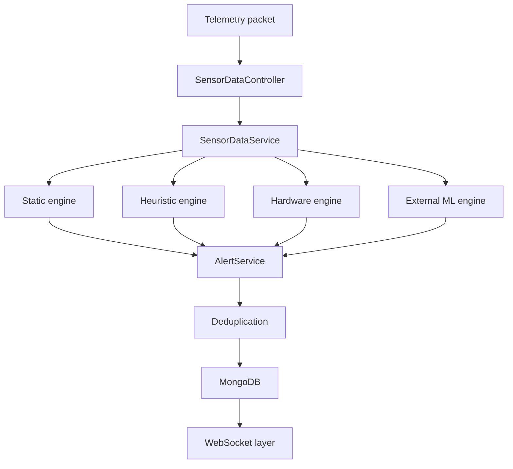

# Backend Tier Architecture

## Overview
The Backend Tier is a Java-based Spring Boot application responsible for ingesting telemetry from the Fog Tier, applying business rules, managing real-time WebSocket broadcasting, and providing a REST API for external consumers. 

* **Status:** Active.

## Objectives
* **Ingestion:** Provide robust HTTP REST endpoints for the Fog Tier to submit sensor data.
* **Real-time Delivery:** Broadcast live telemetry to active frontend clients without polling.
* **Persistence:** Store historical data and alerts reliably.
* **System Monitoring:** Autonomously detect unresponsive sensor nodes and generate alerts.

## Directory Structure
* `platform/api/src/main/java/de/iot/smartmonitoring/`: Core application root.
* `controller/`: REST API endpoints.
* `service/`: Core business logic and alert processing.
* `model/` & `dto/`: Domain entities and Data Transfer Objects.
* `repository/`: Spring Data MongoDB interfaces.
* `websocket/`: Real-time handlers.
* `monitoring/`: Scheduled background jobs.
* `config/`: Spring bean configurations.
* `exception/`: Global error handling.

## Runtime Architecture
* **Implementation:** `SmartMonitoringApplication`.
* **Status:** Active.
The application compiles into a standalone runnable Spring Boot JAR. While the broader orchestration is handled via external mechanisms (documented separately), the backend itself acts as a stateless service designed to connect to an external MongoDB database.

## Startup Sequence
1. **Entry Point:** `SmartMonitoringApplication.java` bootstraps the Spring context.
2. **Configuration:** Loads `MongoConfig`, `OpenApiConfig`, and `WebSocketConfig`.
3. **Connectivity:** Establishes the connection to MongoDB.
4. **Schedulers:** Initializes the `@Scheduled` jobs (e.g., `NodeHealthMonitor`).
5. **Endpoints:** Binds REST controllers and the WebSocket handler to their respective ports/paths.

## API Controller Subsystem
* **Purpose:** Exposes REST endpoints for telemetry ingestion and data retrieval.
* **Components:** 
  * `SensorDataController`: Ingests telemetry and serves historical data (Active).
  * `AlertController`: Serves generated alerts (Active).
  * `NetworkTopologyController`: Ingests and serves the mesh topology state (Active).
  * `NodeController`: Manages sensor node configurations and locations (Active).
* **Dependencies:** Service layer, DTOs.

## Service Layer Subsystem
* **Purpose:** Encapsulates business logic, orchestrates data transformations, and acts as the bridge between controllers and repositories.
* **Components:**
  * `SensorDataService`: Saves telemetry and pushes to WebSockets (Active).
  * `AlertService`: Evaluates thresholds and triggers alerts (Active).
  * `NodeService`: Updates node state and configurations (Active).
  * `NetworkTopologyService`: Persists topology trees (Active).

## DTO and Domain Model Subsystem
* **Purpose:** Defines the data structures for MongoDB persistence and external API communication.
* **Components:** Entities like `SensorData`, `Alert`, `SensorNode`, and `NetworkTopology`. Data Transfer Objects like `SensorDataRequest` and `AlertResponse`.
* **Mappers:** Manual mapping is inferred within the services; no dedicated MapStruct or Mapper classes were found (ENGINEERING INTERPRETATION).
* **Enums:** Strongly typed states like `NodeStatus`, `AlertType`, and `AlertSeverity` (Active).

## Repository Subsystem
* **Purpose:** Manages MongoDB interactions via Spring Data.
* **Components:** Mongo repository interfaces including `SensorDataRepository`, `AlertRepository`, `SensorNodeRepository`, and `NetworkTopologyRepository`.
* **Implementations:** Dynamically generated at runtime by Spring Data MongoDB (ENGINEERING INTERPRETATION).
* **Custom Queries:** Derived query methods are used; no explicit `@Query` annotations exist (Active).

## WebSocket Subsystem
* **Purpose:** Pushes live telemetry to connected dashboard clients.
* **Components:** 
  * `TelemetryWebSocketHandler`: Iterates active TCP sessions, serializes payloads using Jackson's `ObjectMapper`, and broadcasts (Active).
  * `WebSocketConfig`: Maps the handler to `/ws/telemetry` (Active).

## Scheduler and Monitoring Subsystem
* **Purpose:** Periodically sweeps the database to detect offline edge nodes.
* **Components:** 
  * `NodeHealthMonitor`: Uses `@Scheduled(fixedDelayString)` to run every 30 seconds (Active).
  * **Logic:** Compares the node's `lastSeenAt` to a configurable timeout threshold. If exceeded, it triggers `AlertService` to persist a `NODE_OFFLINE` warning (Active).

## Actuator and Health Monitoring
* **Purpose:** Exposes operational information about the running application.
* **Details:** 
  * `spring-boot-starter-actuator` is present in the `pom.xml`.
  * Standard Spring Boot actuator endpoints are therefore available.
  * No custom health indicator classes were discovered in the codebase.
* **Classification:**
  * Actuator integration → VERIFIED
  * Custom health indicators → NOT FOUND
  * `/actuator/health` endpoint → INFERRED

## Configuration Subsystem
* **Purpose:** Centralizes framework configurations.
* **Components:** `MongoConfig`, `OpenApiConfig`, and `WebSocketConfig` (Active).

## Exception-Handling Subsystem
* **Purpose:** Standardizes API error responses globally.
* **Components:** 
  * `GlobalExceptionHandler`: Uses `@ControllerAdvice` to catch unhandled exceptions across all controllers (Active).
  * `ApiErrorResponse`: Formats the error into a consistent JSON structure (Active).

## Validation Subsystem
* **Purpose:** Prevents malformed requests from reaching the service layer.
* **Components:** `@Valid` annotations are utilized in `SensorDataController` and `NodeController` (Active).
* **Dependencies:** Relies on `spring-boot-starter-validation` (Active).

## Asynchronous Processing Subsystem
* **Purpose:** Executes non-blocking background tasks.
* **Components:** Not implemented. Alert evaluation executes synchronously (Unsupported).

## OpenAPI Subsystem
* **Purpose:** Generates interactive API documentation.
* **Components:** `OpenApiConfig` configures the Swagger UI.
* **Integration:** Included via the `springdoc-openapi-starter-webmvc-ui` dependency and `@Parameter` annotations in controllers (Active).

## MongoDB Integration
* **Purpose:** Connects the stateless application to persistent storage.
* **Components:** `MongoConfig` and the `application.yml` properties.
* **Indexes:** Performance optimization is explicitly verified via `@Indexed` and `@Indexed(unique = true)` annotations in `SensorData.java` and `SensorNode.java` (Active).

## Data Flow
1. **Ingestion:** Fog Node sends a POST to `SensorDataController`.
2. **Validation:** `@Valid` ensures payload integrity.
3. **Processing:** `SensorDataService` maps the DTO to the `SensorData` model.
4. **Broadcasting:** `SensorDataService` passes the object to `TelemetryWebSocketHandler` to alert connected UI clients.
5. **Persistence:** `SensorDataService` saves the model via `SensorDataRepository`.
6. **Alert Evaluation:** `AlertService` synchronously evaluates the incoming telemetry against multiple alert engines and persists any triggered `Alert` models.

### Alert-Processing Sequence Diagram

## Failure Scenarios
* **Database Outage:** If MongoDB becomes unreachable, REST controllers will throw data access exceptions. `GlobalExceptionHandler` will catch these and return 500 Internal Server Error responses. WebSockets may continue to function for live transient data depending on the service logic execution order (ENGINEERING INTERPRETATION).
* **Client Disconnects:** Handled gracefully by `TelemetryWebSocketHandler` removing the session from its internal list (Active).
* **Malformed Payloads:** Caught by `@Valid` and rejected with 400 Bad Request by the exception handler (Active).

## Limitations
* Security features (e.g., authentication filters, JWT interceptors) are completely absent from the Spring Boot application layer (Unsupported).
* Caching frameworks (e.g., `@Cacheable`) are not implemented (Unsupported).

## Future Improvements
* Implement Spring Security with JWT validation to secure the REST endpoints.
* Implement DTO mapping libraries (like MapStruct) to cleanly separate domain models from external contracts.
* Add caching to frequently accessed endpoints (e.g., historical topology).

# Multi-Engine Alert Architecture
The backend contains four separate alert engines operating simultaneously within the core business logic.

### Why Multiple Alert Engines?
The system uses four independent engines instead of a single alerting mechanism to cleanly separate distinct operational concerns. Deterministic safety limits (Static Engine), dynamic environmental anomalies (Heuristic Engine), physical hardware failures (Hardware Engine), and predictive machine learning models (External ML Engine) each require fundamentally different mathematical approaches, inputs, and state management. Isolating these prevents complex, monolithic rule definitions and allows for independent tuning and scalability.

## ENGINE 1 – Static Threshold Engine
* **Purpose:** Immediate safety monitoring.
* **Characteristics:** Deterministic, threshold-based, low computational complexity, and immediate response.
* **Examples:** `TEMPERATURE_HIGH`, `TEMPERATURE_LOW`, CO2 alerts, PM alerts, TVOC alerts.
* **Trigger Conditions:** Triggered if raw telemetry exceeds static maximum/minimum boundaries.
* **Input Variables:** Raw sensor values (e.g., `temperature`).
* **Output Variables:** Alert models at `WARNING` severity.
* **Persistence Mechanism:** Synchronous save via `AlertRepository.save()`.
* **Interaction with SensorDataService:** Called synchronously during telemetry ingestion.
* **Classification:** VERIFIED

## ENGINE 2 – Dynamic Heuristic Engine
* **Purpose:** Detect transient events and complex environmental changes while ignoring baseline drift.
* **Characteristics:** Employs rolling statistical analysis, adaptive thresholds, multi-sensor correlation, and noise-floor clamping.
* **Examples:** `TRANSIENT_VOC_EVENT`, `TRANSIENT_CO2_EVENT`, `PARTICULATE_EVENT`, `CLEANING_EVENT`, `VENTILATION_EVENT`, `COMBUSTION_WARNING`, `OCCUPANCY_EVENT`.
* **Trigger Conditions:** Triggered when the maximum value deviates from the rolling mean by a multiple of the standard deviation, clamped to a hardware-specific noise floor.
* **Mathematical Rules:** E.g., `Max > Mean + Math.max(1.5 * Std, noise_floor)`.
* **Input Variables:** Mean, standard deviation, and maximum values for multiple environmental vectors.
* **Output Variables:** Alert models at `INFO` or `WARNING` severities.
* **Persistence Mechanism:** Synchronous save via `AlertRepository.save()`.
* **Note on Rolling Statistics:** The backend consumes statistical features generated elsewhere and therefore does not perform the rolling calculations itself.
* **Classification:** VERIFIED (Rolling-window calculations: ENGINEERING INTERPRETATION)

## ENGINE 3 – Hardware and Topology Health Engine
* **Purpose:** Hardware monitoring, sensor diagnostics, and connectivity monitoring.
* **Examples:** `HARDWARE_FAULT`, `NODE_OFFLINE`.
* **Trigger Conditions:** Triggered by `-999.0` placeholder values, node timeouts, or explicit bit-mask processing.
* **Node Timeout Monitoring:** `@Scheduled` job evaluates `lastSeenAt` timestamps.
* **Self-Healing Behaviour:** Automatic alert resolution occurs when valid sensor data resumes or hardware bit-masks clear.
* **Classification:** VERIFIED

## ENGINE 4 – External Machine-Learning Engine
* **Purpose:** Integrate externally generated alerts into the backend.
* **Examples:** `ML_ANOMALY`, `FORECAST_WARNING`.
* **Integration:** Received via `AlertController` REST API using `CreateAlertRequest`.
* **Classification:** VERIFIED

# Alert Parameters and Detection Rules
| Parameter Name | Value | Units | Formula | Purpose | Rationale | Classification |
| --- | --- | --- | --- | --- | --- | --- |
| `temperature_max` | 35.0 | °C | `Temp > 35.0` | `TEMPERATURE_HIGH` | Safety limit for AC failure | VERIFIED |
| `temperature_min` | 10.0 | °C | `Temp < 10.0` | `TEMPERATURE_LOW` | Safety limit for heating failure | VERIFIED |
| `co2_max` | 1500 | ppm | `CO2 > 1500` | `HIGH_CO2` | Poor air quality requiring ventilation | VERIFIED |
| `pm25_max` | 35.0 | µg/m³ | `PM2.5 > 35.0` | `COMBUSTION_WARNING` | Critical particulate threshold for fire detection | VERIFIED |
| `voc_spike_multiplier` | 1.5 | - | `1.5 * VOCstd` | `TRANSIENT_VOC_EVENT` | Detects sudden VOC spikes (e.g. breath/perfume) | VERIFIED |
| `voc_spike_floor` | 25.0 | ppb | `max(..., 25.0)` | `TRANSIENT_VOC_EVENT` | Ignores baseline noise during clean air | VERIFIED |
| `voc_recovery_floor` | 10.0 | ppb | `max(..., 10.0)` | `TRANSIENT_VOC_EVENT` | Ensures the air has cleared back to baseline | VERIFIED |
| `cleaning_voc_multiplier` | 3 | - | `3 * VOCstd` | `CLEANING_EVENT` | 3-sigma anomaly for chemical sprays | VERIFIED |
| `cleaning_pm_multiplier` | 3 | - | `3 * PMstd` | `CLEANING_EVENT` | 3-sigma anomaly for dust/aerosols | VERIFIED |
| `ventilation_temp_multiplier` | 2 | - | `2 * TempStd` | `VENTILATION_EVENT` | 2-sigma drop in temperature | VERIFIED |
| `ventilation_temp_floor` | 0.2 | °C | `max(..., 0.2)` | `VENTILATION_EVENT` | SCD41 hardware accuracy noise floor | VERIFIED |
| `ventilation_co2_floor` | 30 | ppm | `max(..., 30.0)` | `VENTILATION_EVENT` | SCD41 hardware accuracy noise floor | VERIFIED |
| `moisture_humidity_multiplier`| 3 | - | `3 * HumStd` | `MOISTURE_EVENT` | 3-sigma anomaly in humidity | VERIFIED |
| `moisture_humidity_floor` | 5.0 | %RH | `max(..., 5.0)` | `MOISTURE_EVENT` | SCD41 hardware accuracy noise floor | VERIFIED |
| `occupancy_co2_mean` | 800 | ppm | `CO2mean > 800` | `OCCUPANCY_EVENT` | Indicates sustained human presence | VERIFIED |
| `tvoc_combustion_threshold`| 1000 | ppb | `TVOC > 1000` | `COMBUSTION_WARNING` | Critical VOC threshold for fire detection | VERIFIED |
| `fault_placeholder` | -999.0 | - | `<= -900.0` | `HARDWARE_FAULT` | Sentinel value indicating sensor I2C failure | VERIFIED |
| `info_alert_debounce_seconds` | 300 | seconds | `t > now - 300` | Distributed debounce | Prevents INFO spam on clustered UI | VERIFIED |
| `node_timeout_seconds` | 120 | seconds | `now - 120` | `NODE_OFFLINE` | Disconnect threshold for mesh nodes | VERIFIED |
| `node_health_check_interval_ms`| 30000 | ms | `@Scheduled` | Sweep database | Evaluates node timeouts promptly | VERIFIED |
| `rolling_window_samples` | 30 | samples | Edge side | Statistical smoothing | Filters out transient 1-second noise | ENGINEERING INTERPRETATION |

# Mathematical Detection Rules

### 1. Sustained CO₂ detection
**Implementation:**
`CO2 > CO2max AND CO2mean > 0.8 × CO2max AND CO2std < 150`
**Explanation:**
The raw CO2 must exceed the threshold (1500 ppm), the rolling mean must be over 80% of the threshold, and the standard deviation must be tight (under 150 ppm). This ensures the system ignores sudden transient spikes (like someone breathing directly on the sensor) and only alerts on sustained poor air quality.

### 2. Transient VOC detection
**Implementation:**
`VOCmax > VOCmean + max(1.5 × VOCstd, 25) AND VOCcurrent < VOCmean + max(VOCstd, 10)`
**Explanation:**
The highest VOC reading in the rolling window must be at least 1.5 standard deviations above the mean (clamped to a 25 ppb noise floor). Furthermore, the current raw VOC must have already dropped back down to near the mean (clamped to a 10 ppb recovery floor), indicating a fast spike that rapidly dispersed.

### 3. Cleaning-event detection
**Implementation:**
`VOCmax > VOCmean + max(3 × VOCstd, 25) AND PMmax > PMmean + max(3 × PMstd, 5)`
**Explanation:**
Both VOCs and Particulates must simultaneously register a 3-sigma anomaly spike above their respective noise floors. Chemical aerosol sprays and dusting activities produce both VOCs and particulates simultaneously.

### 4. Ventilation-event detection
**Implementation:**
`Temperature < Temperaturemean − max(2 × Temperaturestd, 0.8) AND CO2 < CO2mean − max(2 × CO2std, 50 + 0.03 × CO2mean)`
**Explanation:**
Both Temperature and CO2 must drop by 2 standard deviations below the mean, bounded by hardware noise floors from the Sensirion SCD4x datasheet (0.8°C typical accuracy, 15–35°C range, and a CO2 floor of 50 ppm + 3% of the current reading). Opening a window or engaging HVAC flushes warm, CO2-rich indoor air, replacing it with cooler fresh air.

### 5. Moisture-event detection
**Implementation:**
`Humidity > Humiditymean + max(3 × Humiditystd, 6) AND CO2std < 10`
**Explanation:**
A 3-sigma spike in humidity occurs while the CO2 standard deviation remains completely flat/stable. A human breathing on the sensor produces both humidity and CO2. By ensuring CO2 is perfectly flat, the system isolates pure moisture anomalies (e.g., a spill or leak).

### 6. Occupancy detection
**Implementation:**
`CO2mean > 800 AND CO2std < 50`
**Explanation:**
Elevated but highly stable CO2 (under 50 ppm standard deviation) strongly correlates with sustained human presence in a sealed room.

### 7. Combustion detection
**Implementation:**
`PM2.5 > 35 AND TVOC > 1000 AND Temperature > Temperaturemean + (2 × Temperaturestd)`
**Explanation:**
A multi-sensor fusion correlation. A fire produces high particulate smoke (> 35), high VOCs (> 1000), and an anomalous rise in temperature (2-sigma above the rolling baseline) simultaneously.

### 8. Hardware-fault detection
**Implementation:**
`(healthStatus & 0x01) == 0` (Temp/Hum)
`(healthStatus & 0x02) == 0` (CO2)
`(healthStatus & 0x04) == 0` (PM)
`(healthStatus & 0x08) == 0` (VOC)
**Explanation:**
The edge firmware sets specific bits to zero to indicate I2C failures on specific physical sensor chips (SCD41, SPS30, CCS811). The backend unpacks this bitmask to generate specific repair instructions.

# Design Rationale

* **Threshold-based detection:** Used for critical safety parameters (e.g., Temperature, absolute CO2) where immediate, deterministic alerts are required regardless of historical baselines.
* **Statistical heuristics:** Essential for detecting dynamic events (like a transient breath or an open window) that depend on relative changes rather than absolute numbers. It ignores slow environmental drift.
* **Multi-sensor correlation:** Eliminates false positives by fusing distinct vectors. For example, a VOC spike combined with a PM2.5 spike isolates an active cleaning event from a simple perfume spray.
* **Rolling statistics:** Smooths out raw sensor jitter, providing a reliable baseline (mean) and a measure of volatility (standard deviation) to base dynamic rules upon.
* **Noise-floor clamping:** Extremely crucial for high-precision digital sensors. When the air is perfectly clean, the standard deviation approaches zero, causing even a microscopic 1 ppb change to trigger a 3-sigma anomaly. Clamping (e.g., `max(..., 25)`) enforces a hardware-specific minimum absolute change.
* **Debounce mechanisms:** Implemented to suppress identical `INFO` severity events across a 300-second window, preventing database spam and UI clutter on the dashboard.
* **Self-healing:** The backend actively clears `HARDWARE_FAULT` alerts automatically if valid sensor data resumes, preventing stale, latched alerts from masking current operational state.
* **Hardware-fault detection:** Sentinel values (`-999.0`) and bitmasks (`healthStatus`) bridge the gap between physical embedded hardware failures and high-level software alerting, enabling precise diagnostic instructions for maintenance.
* **Edge-side statistical processing:** Offloading the 30-sample rolling window calculations to the embedded/fog tier minimizes the computational load on the centralized Spring Boot backend, allowing it to scale effortlessly to thousands of nodes.
* **Separation of ML processing from the backend:** Decoupling the ML Python service from the Java backend ensures that heavy forecasting tasks or GPU dependencies do not block the high-throughput, low-latency telemetry ingestion pipeline.

# Alert Lifecycle
* **Ingestion:** Telemetry arrives at the API and is validated.
* **Evaluation:** Evaluated synchronously against the multi-engine alert architecture.
* **Persistence:** Valid alerts are stored in MongoDB.
* **Deduplication:** State alerts are deduplicated via DB queries. `INFO` severity alerts use a distributed debounce mechanism (suppressing identical events for 300 seconds).
* **Categorization:** Categorized as `OPERATIONAL`, `AI`, or `INFRA`.
* **Severity Assignment:** Assigned as `INFO`, `WARNING`, or `CRITICAL`.
* **Resolution:** Manual via API, or automatic self-healing behaviour (e.g. when physical sensor hardware recovers).
* **Archival:** Retained in MongoDB for historical query.

## Feature Classification Summary
* **Active:** API Controllers, Spring Data MongoDB integration, `@Valid` Request validation, `@Scheduled` node health monitoring, `/ws/telemetry` WebSockets, Global Exception Handling, `@Indexed` database performance tuning, Multi-Engine Alert Architecture, Distributed Debounce, Automatic Self-Healing.
* **Inferred:** Actuator `/actuator/health` endpoint existence (due to starter dependency).
* **Engineering Interpretation:** Manual DTO mapping logic, automatic repository interface implementations by Spring, Rolling-window calculations at the edge/fog tier.
* **Unsupported:** Explicit `@Query` statements, Spring Security, Custom Filters, Caching, Event Listeners, `@Async` asynchronous alert processing.
* **Deprecated:** None identified within the active codebase.
