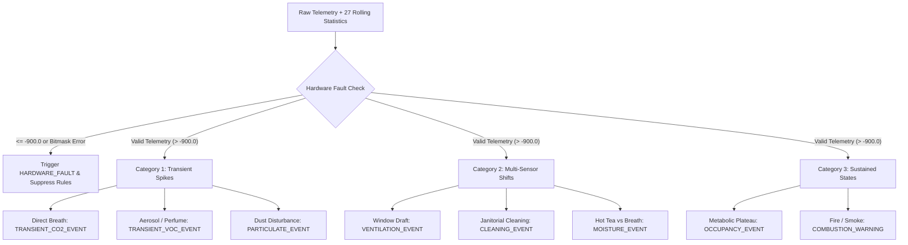

# Backend Alert Service & Environmental Heuristics Layer

This document details the architectural design, static safety bounds, physical hardware fault detection bitmasks, and dynamic multi-sensor statistical heuristics implemented within the Spring Boot Backend API (`platform/api/src/main/java/de/iot/smartmonitoring/service/AlertService.java`).

---

## Executive Summary

The **Backend Alert Service Layer** acts as the central intelligence engine of the **Thread-Based Intelligent Indoor Environmental Monitoring System (`CoAP over OpenThread mesh network`)**. While edge sensor nodes (`nRF52840`) continuously sample real-world environmental phenomena and compute local rolling statistics, the centralized Spring Boot API (`smart-monitoring-api`) processes these telemetry streams to detect anomalies, hardware failures, and complex indoor events.

To eliminate **alarm fatigue**—a prevalent failure mode in traditional IoT deployments where single-parameter static thresholds trigger false alarms (e.g., a student exhaling directly onto a desk sensor)—our backend implements a **Dual-Engine Architecture**:
1. **Static Safety Thresholds (`application.yml`)**: Absolute upper and lower physical bounds designed to catch severe environmental hazards, HVAC failures, and combustion risks.
2. **Dynamic Multi-Sensor Statistical Heuristics (`AlertService.java`)**: Advanced classification rules that correlate up to 27 rolling statistical features (`Mean`, `StdDev`, `Max` over a 3-minute / 30-sample window) across multiple independent sensors (`SCD41`, `SPS30`, `CCS811`) to accurately classify complex real-world indoor activities.

---

## 💡 Viva & Defense Quick Reference (30-Second Summary)

When explaining the Backend Alert Service during your oral defense, presentation, or Q&A, use this concise summary:

> *"Our Spring Boot Backend does not rely on simple static threshold checks alone, which would trigger false alarms every time someone breathes near a desk sensor.*
> 
> *Instead, it operates a dual-engine evaluation pipeline. First, it checks absolute safety bounds and physical hardware error bitmasks (`healthStatus`) to detect disconnected or frozen sensors. Second, it evaluates 8 multi-sensor statistical heuristics using the 27 rolling statistical features (`Mean`, `StdDev`, `Max`) sent inside the 800-byte CBOR packets from our edge nodes.*
> 
> *By correlating multiple independent sensors—for example, verifying that both Temperature and $\text{CO}_2$ drop simultaneously to detect an open window, or requiring $\text{CO}_2$ variance to remain near zero while humidity rises to distinguish hot tea from human breath—we eliminate single-sensor false positives and achieve highly reliable indoor event classification."*

### Key Viva Q&A

* **Q: Why run these statistical heuristics on the Java Backend instead of directly on the `nRF52840` Microcontroller?**
  * **A:** Our `nRF52840` edge node efficiently computes the 3-minute rolling window statistics (`Mean`, `StdDev`, `Max`) directly on-device and compresses them into lightweight 800-byte CBOR packets. However, evaluating multi-packet historical trends, enforcing distributed 5-minute anti-spam timers (`300s window`), persisting alerts to MongoDB, and broadcasting instant WebSocket updates require centralized state and database access. Furthermore, running `AlertService.java` on the backend allows administrators to dynamically adjust alert rules and thresholds without re-compiling C++ firmware or re-flashing 50+ embedded wireless mesh nodes.
* **Q: How do you prevent a broken or disconnected sensor from triggering false environmental alarms?**
  * **A:** Our backend enforces a strict multi-layered safety filter. If a physical sensor suffers an I2C communication fault or power disconnection, the firmware outputs `-999.0`. Before executing any heuristic, `AlertService.java` verifies sensor validity (`> -900.0`) and evaluates the exact `healthStatus` bitmask (`0x01` to `0x08`), instantly triggering a `HARDWARE_FAULT` alert while suppressing false environmental evaluations. Once the hardware recovers (`healthStatus == 255`), our **self-healing logic automatically resolves the latched fault in MongoDB**.

---

## 1. Environmental Parameters & Sensor Mapping to International Health Guidelines

As defined in Section 4.1 of the project proposal (`revised-project-proposal(v2).md`), our system employs a suite of complementary hardware sensors measuring distinct environmental parameters mapped directly to international health guidelines (**ASHRAE**, **WHO**, **EPA**, and **WELL v2**). Sensor readings are sampled on the edge microcontroller and transmitted via CoAP over Thread to the backend.

These health guideline limits are explicitly bound to our Spring Boot Backend API via `@Value("${app.alerts.*}")` properties in `application.yml`, allowing synchronous evaluation within `AlertService.java` whenever a reading breaches absolute safety thresholds:

### 1.1 Proposal Mapping Table (Hardware, Typical Ranges & Health Guidelines)

| Measurement | Hardware Transducer | Typical Indoor Range | International Health Guideline Threshold | Backend Config Key (`application.yml`) | Backend Default Value | Severity | Alert Type Triggered (`AlertService.java`) | Recommended Operator Action |
| :--- | :--- | :--- | :--- | :--- | :--- | :--- | :--- | :--- |
| **$\text{CO}_2$** | **Sensirion SCD41** *(Photoacoustic NDIR)* | $400 - 1,000\text{ ppm}$ | **$> 1,500\text{ ppm}$** *(ASHRAE Position Doc. on Indoor $\text{CO}_2$)* | `co2-max` | `1,500.0 ppm` | `WARNING` | `HIGH_CO2` | *"Increase fresh air intake."* |
| **Humidity** | **Sensirion SCD41** *(Capacitive RH)* | $30\% - 60\%$ | **$> 60\%$ or $< 20\%$** *(OSHA)* | `humidity-max`<br/>`humidity-min` | `60.0 %RH`<br/>`20.0 %RH` | `WARNING` | `HUMIDITY_HIGH`<br/>`HUMIDITY_LOW` | *"Check for water leaks or inspect dehumidifier/ventilation."*<br/>*"Check heating/HVAC dryness; consider a humidifier."* |
| **Temperature** | **Sensirion SCD41** *(Onboard Temperature)* | $19^\circ\text{C} - 28^\circ\text{C}$ | **$> 35^\circ\text{C}$ or $< 10^\circ\text{C}$** *(ASHRAE 55)* | `temperature-max`<br/>`temperature-min` | `35.0 °C`<br/>`10.0 °C` | `WARNING` | `TEMPERATURE_HIGH`<br/>`TEMPERATURE_LOW` | *"Inspect AC unit; ensure area is shaded."*<br/>*"Check heating systems; close external windows."* |
| **$\text{PM}_{2.5}$ / $\text{PM}_{10}$** | **Sensirion SPS30** *(Laser Optical Scattering)* | $0 - 45\ \mu\text{g/m}^3$ | **$> 35\ \mu\text{g/m}^3$** *(EPA NAAQS)* | `pm25-max` | `35.0 µg/m³` | `CRITICAL` | `COMBUSTION_WARNING` *(Multi-sensor)* | *"Evacuate and investigate immediately."* |
| **TVOC** | **Adafruit CCS811** *(Metal Oxide Semiconductor)* | $0 - 500\text{ ppb}$ | **$> 1,000\text{ ppb}$** *(WELL v2)* | `tvoc-max` | `1,000.0 ppb` | `WARNING` | `SUSTAINED_ENVIRONMENTAL_CHANGE` | *"Check ventilation system immediately."* |

---

## 2. Physical Hardware Fault Detection & Self-Healing

In production embedded networks, physical sensors may encounter transient I2C bus lockups, wiring disconnections, or voltage droops. The backend isolates physical hardware failures from environmental anomalies:

### 2.1 Fault Placeholder Detection
When an edge sensor node fails to read from a physical sensor transducer, it assigns a sentinel placeholder value of `-999.0`. The ingestion pipeline intercepts this immediately (`AlertService.java:47`):

$$\text{HasHardwareFault} = (\text{Temp} \le -900) \lor (\text{Humidity} \le -900) \lor (\text{CO}_2 \le -900) \lor (\text{TVOC} \le -900) \lor (\text{PM}_{2.5} \le -900)$$

### 2.2 Health Status Bitmask Decoding
When `HasHardwareFault` is true, the backend evaluates the 8-bit `healthStatus` integer to identify the exact failing hardware module (`AlertService.java:356-400`):

| Bit Position | Bitmask Check | Sensor Module | Failure Diagnosis | Automated Recommended Action |
| :---: | :---: | :--- | :--- | :--- |
| **Bit 0** | `(healthStatus & 0x01) == 0` | `SCD41` (Temp / Humidity) | Transducer read failure | *"Check Temperature sensor wiring."* |
| **Bit 1** | `(healthStatus & 0x02) == 0` | `SCD41` ($\text{CO}_2$) | I2C communication timeout | *"Verify CO2 sensor I2C connection."* |
| **Bit 2** | `(healthStatus & 0x04) == 0` | `SPS30` (Particulate Matter) | Optical laser / fan failure | *"Inspect PM sensor 5V power supply."* |
| **Bit 3** | `(healthStatus & 0x08) == 0` | `CCS811` (Total VOCs) | Heater plate / baseline fault | *"Check VOC sensor heater pins."* |

### 2.3 Statistical Sensor Freeze Detection
If a sensor hardware register freezes, it may output a constant, repeating numeric value above $-900.0$ (e.g., stuck at exactly `400.0 ppm` for hours). The backend detects this by inspecting standard deviation (`AlertService.java:66`):

$$\text{If } (\text{TVOC}_{\text{Std}} == 0.0 \land \text{TVOC}_{\text{Mean}} > 0) \implies \text{Trigger } \textbf{HARDWARE\_FAULT} \text{ (CRITICAL: "Sensor may be frozen")}$$

### 2.4 Self-Healing Auto-Resolution
When a sensor node is power-cycled or recovers from a transient wire disconnection, its health bitmask returns to `255` (`0xFF` / all healthy) and telemetry returns $> -900.0$. The backend executes an automated self-healing transaction (`AlertService.java:55`):
* Queries `AlertRepository` for any active, unresolved `HARDWARE_FAULT` for that specific `nodeId`.
* Sets `alert.setResolved(true)` and commits to MongoDB.
* Logs: `"Self-Healing: Auto-resolved latched HARDWARE_FAULT after hardware recovery."`

---

## 3. Dynamic Statistical & Multi-Sensor Heuristics

To classify complex indoor events without triggering false positives, `AlertService.java` evaluates 8 multi-sensor algorithmic rules across three behavioral categories:



---

### Category 1: Transient Spikes (`Spike & Recovery`)
Catches rapid, short-duration disturbances where the instantaneous maximum reading (`Max`) spikes dramatically above the rolling mean while the current instantaneous reading (`Value`) has already recovered toward baseline.

#### 1. Transient $\text{CO}_2$ Event (Direct Human Breath)
* **Algorithmic Condition (`AlertService.java:114`)**:
  $$\text{CO}_{2\text{Max}} > \text{CO}_{2\text{Mean}} + \max(2.0 \times \text{CO}_{2\text{Std}}, 100.0) \quad \textbf{AND} \quad \text{CO}_2 < \text{CO}_{2\text{Mean}} + \max(\text{CO}_{2\text{Std}}, 30.0)$$
* **Domain Rationale**: If a person leans over a desk and exhales right over the `SCD41` sensor, $\text{CO}_{2\text{Max}}$ jumps sharply (`+100 ppm` hardware noise floor). Because the current reading has dropped back near the mean ($\text{CO}_2 < \text{Mean} + \text{Std}$), the system recognizes this as a transient exhale rather than a room-wide ventilation emergency.
* **Classification**: Logged as `TRANSIENT_CO2_EVENT` (`Severity: INFO`, Auto-resolved).

#### 2. Transient VOC Event (Perfume / Aerosols / Sanitizer)
* **Algorithmic Condition (`AlertService.java:75`)**:
  $$\text{TVOC}_{\text{Max}} > \text{TVOC}_{\text{Mean}} + \max(1.5 \times \text{TVOC}_{\text{Std}}, 25.0) \quad \textbf{AND} \quad \text{TVOC} < \text{TVOC}_{\text{Mean}} + \max(\text{TVOC}_{\text{Std}}, 10.0)$$
* **Domain Rationale**: Hand sanitizers, colognes, or isopropyl alcohol wipes release fat VOC spikes that expand variance (`StdDev`). Enforcing a minimum `25 ppb` absolute jump prevents electrical noise from triggering events.
* **Classification**: Logged as `TRANSIENT_VOC_EVENT` (`Severity: INFO`, Auto-resolved).

#### 3. Particulate Event (Dust Disturbance)
* **Algorithmic Condition (`AlertService.java:98`)**:
  $$\text{PM}_{2.5\text{Max}} > \text{PM}_{2.5\text{Mean}} + \max(3.0 \times \text{PM}_{2.5\text{Std}}, 5.0) \quad \textbf{AND} \quad \text{PM}_{2.5} < \text{PM}_{2.5\text{Mean}} + \text{PM}_{2.5\text{Std}}$$
* **Domain Rationale**: Shaking clothes, adjusting curtains, or moving books near the `SPS30` optical sensor. A noise floor of `5.0 µg/m³` matches the manufacturer accuracy specification for the Sensirion SPS30.
* **Classification**: Logged as `PARTICULATE_EVENT` (`Severity: INFO`, Auto-resolved).

---

### Category 2: Multi-Sensor Shifts (Cross-Domain Correlation)
Eliminates single-sensor false positives by requiring simultaneous statistical shifts across **two independent physical domains** before triggering an event.

#### 4. Rapid Ventilation Event (Window or Door Opened)
* **Algorithmic Condition (`AlertService.java:143`)**:
  $$\text{Temp} < \text{Temp}_{\text{Mean}} - \max(2.0 \times \text{Temp}_{\text{Std}}, 0.2^\circ\text{C}) \quad \textbf{AND} \quad \text{CO}_2 < \text{CO}_{2\text{Mean}} - \max(2.0 \times \text{CO}_{2\text{Std}}, 30.0\text{ ppm})$$
* **Domain Rationale**: Single-sensor drops in temperature can be caused by AC cycling, while single-sensor drops in $\text{CO}_2$ can be caused by people leaving. However, when **both Temperature AND $\text{CO}_2$ drop simultaneously** below their 2-sigma rolling bounds (`0.8 °C` and `50 ppm + 3% of reading` noise floors, per the Sensirion SCD4x datasheet), it mathematically confirms a rapid influx of fresh outdoor air from an open window or door.
* **Classification**: Logged as `VENTILATION_EVENT` (`Severity: INFO`, Auto-resolved).

#### 5. Active Janitorial Cleaning Event
* **Algorithmic Condition (`AlertService.java:157`)**:
  $$\text{TVOC}_{\text{Max}} > \text{TVOC}_{\text{Mean}} + \max(3.0 \times \text{TVOC}_{\text{Std}}, 25.0) \quad \textbf{AND} \quad \text{PM}_{2.5\text{Max}} > \text{PM}_{2.5\text{Mean}} + \max(3.0 \times \text{PM}_{2.5\text{Std}}, 5.0)$$
* **Domain Rationale**: When janitorial staff clean an indoor room, wiping desks with chemical sprays releases volatile organic compounds (`TVOC` spike) while mechanical scrubbing kicks up settled dust (`PM2.5` spike). Requiring simultaneous 3-sigma deviations across both chemical and optical sensors uniquely isolates janitorial cleaning from other activities.
* **Classification**: Logged as `CLEANING_EVENT` (`Severity: INFO`, Auto-resolved).

#### 6. Localized Moisture Event (Hot Tea vs. Human Breath)
* **Algorithmic Condition (`AlertService.java:171`)**:
  $$\text{Humidity} > \text{Humidity}_{\text{Mean}} + \max(3.0 \times \text{Humidity}_{\text{Std}}, 6.0\%) \quad \textbf{AND} \quad \text{CO}_{2\text{Std}} < 10.0\text{ ppm}$$
* **Domain Rationale**: A major engineering challenge is distinguishing steam from a hot drink (cup of tea/coffee near the sensor) from human respiration. Both phenomena cause a sharp local humidity spike (`+6% RH` accuracy floor, per the Sensirion SCD4x datasheet). However, human breath is rich in $\text{CO}_2$, whereas steam from a hot cup contains zero $\text{CO}_2$. By enforcing $\text{CO}_{2\text{Std}} < 10.0\text{ ppm}$ (stable/flat $\text{CO}_2$ variance), the backend reliably confirms localized steam/moisture.
* **Classification**: Logged as `MOISTURE_EVENT` (`Severity: INFO`, Auto-resolved).

---

### Category 3: Sustained States & High-Severity Warnings
Monitors long-term stability ($\text{StdDev}$) to confirm persistent room states or detect life-safety emergencies.

#### 7. Presence / Occupancy Plateau (`OCCUPANCY_EVENT`)
* **Algorithmic Condition (`AlertService.java:125`)**:
  $$\text{CO}_{2\text{Mean}} > 800.0\text{ ppm} \quad \textbf{AND} \quad \text{CO}_{2\text{Std}} < 50.0\text{ ppm}$$
* **Domain Rationale**: Transforms the `SCD41` gas sensor into a **camera-less, privacy-preserving human occupancy detector**. When humans enter an enclosed room, metabolic respiration causes $\text{CO}_2$ to rise steadily and eventually plateau around equilibrium ($>800\text{ ppm}$). Low, stable variance ($\text{StdDev} < 50\text{ ppm}$) confirms continuous human presence rather than a transient spike.
* **Classification**: Logged as `OCCUPANCY_EVENT` (`Severity: INFO`, Auto-resolved).

#### 8. Sustained Environmental Change (Ventilation Failure)
* **Algorithmic Condition (`AlertService.java:88`)**:
  $$\text{TVOC} > \text{tvocMax} \quad \textbf{AND} \quad \text{TVOC}_{\text{Mean}} > (\text{tvocMax} \times 0.8) \quad \textbf{AND} \quad \text{TVOC}_{\text{Std}} < 100.0\text{ ppb}$$
* **Domain Rationale**: If VOC levels remain consistently elevated above `1000 ppb` with low variance ($\text{StdDev} < 100\text{ ppb}$), the room lacks adequate air exchange.
* **Classification**: Logged as `SUSTAINED_ENVIRONMENTAL_CHANGE` (`Severity: WARNING`, Persistent: *"Check ventilation system immediately"*).

#### 9. Combustion Warning (Multi-Domain Fire / Smoke Detection)
* **Algorithmic Condition (`AlertService.java:185`)**:
  $$\text{PM}_{2.5} > \text{pm25Max} \quad \textbf{AND} \quad \text{TVOC} > \text{tvocMax} \quad \textbf{AND} \quad \text{Temp} > \text{Temp}_{\text{Mean}} + (2.0 \times \text{Temp}_{\text{Std}})$$
* **Domain Rationale**: Life-safety fire detection. A real fire emits thick smoke particles ($\text{PM}_{2.5} > 35\ \mu\text{g/m}^3$), toxic burning gases ($\text{TVOC} > 1000\text{ ppb}$), and rapid exothermic thermal rise ($\text{Temp} > \text{Mean} + 2\sigma$). Requiring all three domains to spike simultaneously eliminates false fire alarms from isolated kitchen cooking or aerosol sprays.
* **Classification**: Logged as `COMBUSTION_WARNING` (`Severity: CRITICAL`, Persistent: *"Evacuate and investigate immediately"*).

---

## 4. Deduplication & Anti-Spam Architecture

In high-frequency IoT networks where sensor nodes transmit every few seconds, unthrottled alert generation can overwhelm database storage and flood user interfaces. `AlertService.java:413-451` enforces strict deduplication strategies:

### 4.1 Distributed Debounce for `INFO` Events (Anti-Spam)
All heuristic events classified with `Severity: INFO` (`TRANSIENT_CO2`, `VENTILATION_EVENT`, `OCCUPANCY_EVENT`, etc.) represent self-contained historical observations and are automatically inserted with `resolved = true`. To prevent activity feed spam when a condition persists across consecutive packets:
* The backend queries MongoDB (`findFirstByNodeIdAndTypeOrderByCreatedAtDesc`) for the most recent alert of that exact type for that specific node.
* If an identical event was recorded within the last **300 seconds (5 minutes)**, the new alert is silently suppressed:
  ```java
  if (recent.isPresent() && recent.get().getCreatedAt().isAfter(Instant.now().minusSeconds(300))) {
      return; // Suppress spam for 5 minutes
  }
  ```
* **HA Debounce Reset (`resetDebounceTimers()`)**: In high-availability setups or automated testing routines, calling `/api/sensor-data/alerts/reset-debounce` purges recent `INFO` events from MongoDB (`deleteBySeverity`), resetting the distributed timer across all gateway nodes.

### 4.2 Latching & Deduplication for `WARNING` / `CRITICAL` Alerts
For high-severity alerts (`TEMPERATURE_HIGH`, `HIGH_CO2`, `HARDWARE_FAULT`, `COMBUSTION_WARNING`), the system requires explicit operator resolution or automated self-healing:
* Before creating a warning or critical alert, `AlertService.java` checks if an **unresolved** alert of that exact type already exists for the node (`findFirstByNodeIdAndTypeAndResolvedFalse`).
* If `existing.isPresent() == true`, the new alert is discarded (`return;`). This guarantees that a sensor reporting continuous overheating (`38 °C` every 10 seconds for 5 hours) results in exactly **one latched warning row** in MongoDB until an operator resolves it or the temperature returns to safe operating bounds.
