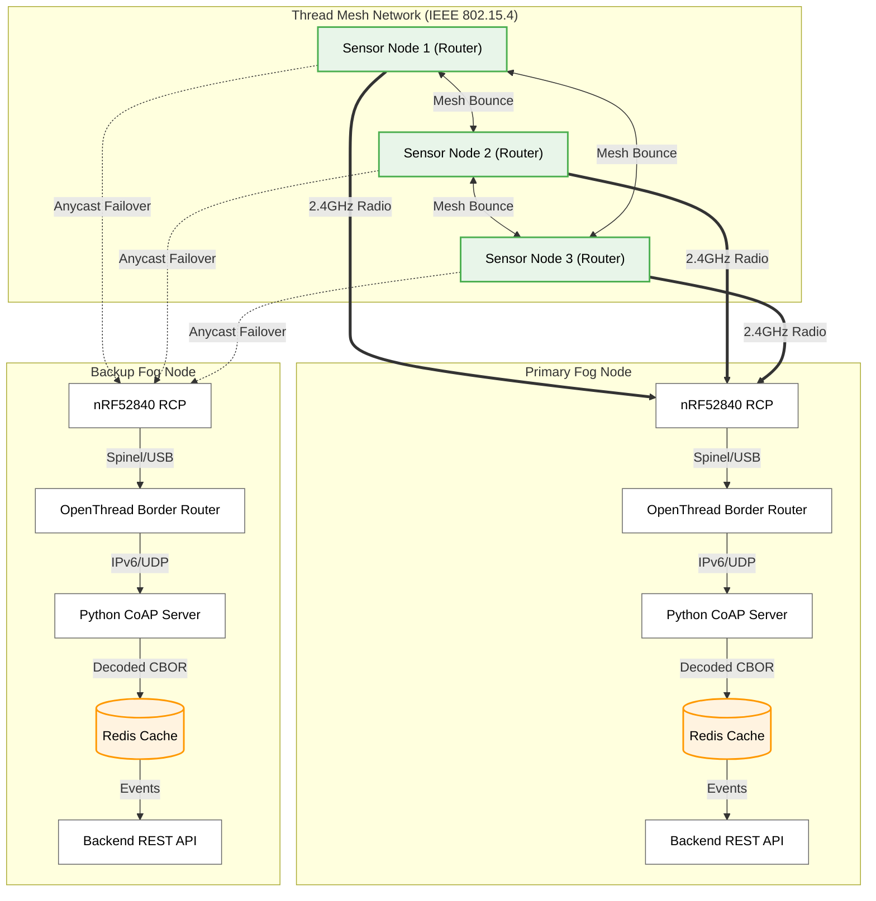

# SSNS — "The Journey of a Data Packet"
**Storytelling Presentation Format (~5-8 minutes)**

*Abstract: This document provides a structured presentation outline detailing the lifecycle and network traversal of a telemetry packet within the SSNS architecture. It includes proposed slide visuals and corresponding narrative talking points for the presenters.*

---

## Slide 1: The Hardware Platform (nRF52840)

**Slide Visuals:**

| Component | Specification |
|-----------|---------------|
| **Microcontroller** | Nordic nRF52840 (64 MHz ARM Cortex-M4) |
| **Memory** | 1 MB Flash / 256 KB RAM |
| **Radio Protocol** | 2.4 GHz IEEE 802.15.4 (OpenThread) |
| **Operating System**| Zephyr RTOS |

**Presentation Narrative:**
"Before we follow our data, let's look at what generates it. We built our sensor nodes on the Nordic nRF52840 microcontroller, running the Zephyr Real-Time Operating System. 

It features a 64 megahertz ARM processor, 1 megabyte of flash memory, and 256 kilobytes of RAM. While that sounds tiny compared to a laptop, it provides plenty of power for local data processing. Most importantly, it features a built-in 2.4 Gigahertz radio that natively supports the IEEE 802.15.4 standard, which is the exact physical layer required to run our Thread mesh network."

---

## Slide 2: The Observer (6 Seconds in the Room)

**Slide Visuals:**
- **The Hardware:** nRF52840 Microcontroller + 3 I²C Sensors
- **The Rule:** Sample every 6 seconds, transmit every 30 seconds.
- **The Format:** CBOR (Concise Binary Object Representation) — 821 bytes vs 4,000 bytes (JSON).

**Presentation Narrative:**
"Good afternoon. Today I want to tell you the story of a single data packet in our Smart Sensor System, tracing its journey from a physical room all the way to our Redis cache.

It starts at the sensor node. Our microcontroller wakes up every 6 seconds to read CO₂, temperature, humidity, and volatile organics. We chose 6 seconds because the CO₂ sensor physically requires 5.5 seconds between readings.

But we don't transmit immediately. To save battery and reduce radio traffic, the node waits until it has collected 5 readings over 30 seconds. It then bundles those 5 readings into a highly compressed binary format called CBOR. This reduces the payload size from 4,000 bytes down to just 800 bytes, which is critical for low-power wireless networks."

---

## Slide 3: The Thinker (Why Statistics Matter)

**Slide Visuals:**
- **The Problem:** A spike in CO₂ might only last 15 seconds. If you transmit every 30 seconds, you miss it.
- **The Solution:** A rolling 3-minute statistical window (buffer of 30 samples).
- **The Result:** We compute Mean, Standard Deviation, and Maximum to detect *events* (e.g., Active Cleaning, Rapid Ventilation, Occupancy).

**Presentation Narrative:**
"Before that packet leaves the sensor, something very important happens: the microcontroller calculates statistics. Why do we do this?

Imagine someone opens a door, causing a 15-second spike in CO₂. If we only transmit a reading every 30 seconds, that spike might happen entirely between transmissions. The backend would never see it. 

Instead, the firmware maintains a rolling 3-minute window—a memory buffer holding the last 30 samples. Before transmitting, it calculates the Maximum and the Standard Deviation across that entire 3-minute window, and includes that in the packet. Now, the backend doesn't just see numbers—it sees events. If both volatile organics and particulate matter spike with a high standard deviation, the backend knows a room is actively being cleaned. These 3-minute statistics give us high-resolution event awareness, without the cost of high-frequency transmission."

---

## Slide 4: The Journey (Over the Thread Mesh)

**Slide Visuals:**
- **The Protocol:** CoAP (Constrained Application Protocol) Confirmable messages.
- **The Rule:** Every packet demands a handshake (ACK) from the gateway.

**Presentation Narrative:**
"Once the packet is packed and compressed, it begins its journey over the Thread mesh network. You can see this in the green lines on the diagram.

Thread is a self-healing wireless mesh. If the direct path to the gateway is blocked, the packet automatically bounces through neighboring sensor nodes—shown by the dashed blue lines—to find its way.

We use a protocol called CoAP, and specifically, we use 'Confirmable' messages. This means our sensor node refuses to just throw data into the air. When it sends that packet, it starts a 5-second timer, waiting for a guaranteed handshake back from the gateway."

---

## Slide 5: The Safety Net (When the Handshake Fails)

**Slide Visuals:**
- **The Trigger:** 3 consecutive CoAP timeouts.
- **The Action:** Save the CBOR batch to the Local RAM Queue.
- **The Capacity:** 50 slots = 25 minutes of complete offline coverage with zero data loss.

**Presentation Narrative:**
"But what happens if the network is down and that handshake never comes? 

If the sensor fails to get an acknowledgement 3 times in a row, it triggers its safety net. It takes that exact CBOR packet and saves it into a local RAM queue on the microcontroller, which you can see on the far right of the diagram.

We reserved enough memory to hold 50 packets. Because we only transmit every 30 seconds, this gives the node 25 minutes of complete offline coverage. It sits there, quietly hoarding data, waiting for the network to return."

---

## Slide 6: The Detour (Autonomous Anycast Failover)

**Slide Visuals:**
- **The Strategy:** Bypassing Duplicate Address Detection.
- **The Magic:** Two Border Routers sharing the exact same IPv6 address (`fd5e:a726:ec55:ee12::1`).
- **The Result:** ~30-second autonomous failover.

**Presentation Narrative:**
"If the gateway is dead, the sensor needs a detour. It restarts its radio and begins a 'Parent Search' for a new gateway.

Normally, every computer on a network needs a unique IP address. We broke that rule. We configured both of our Border Routers—the primary and the backup fog nodes—to share the exact same 'Anycast' IPv6 address. 

The sensor doesn't know there are two routers. It just searches for that one address. If the Primary Fog Node crashes, the sensor automatically discovers the backup router, attaches to it, and resumes sending. The total failover time is roughly 30 seconds. And as soon as that first packet is acknowledged, the sensor instantly drains its 25-minute offline queue, ensuring zero data loss."

---

## Slide 7: The Multi-Lane Highway (Active-Active Load Balancing)

**Slide Visuals:**
- **The Magic of Anycast:** OpenThread routes traffic to the physically nearest Fog Node.
- **The Result:** Intrinsic spatial load balancing (Active-Active Architecture).
- **The Resilience:** Zero-downtime roaming if a sensor moves or a radio link degrades.

**Presentation Narrative:**
"But Anycast doesn't just give us failover—it gives us load balancing. What happens if *both* Fog Nodes are online at the same time? Do they conflict? 

No. In fact, this creates a massive 'Multi-Lane Highway' for our data. Because both Border Routers advertise the exact same address, the OpenThread mesh uses distance-vector routing to automatically split the traffic. 

If Sensor 1 is physically closer to the Primary Fog Node, its packets route there. If Sensor 3 is closer to the Backup Fog Node, its packets route there. Because each Fog Node runs its own independent backend stack, they process the data locally without stepping on each other's toes. And if a door closes and ruins Sensor 1's connection to the Primary node, the Thread network seamlessly routes it to the Backup node instead. This gives us incredible scale and resilience."

---

## Slide 8: The Destination (From Radio to Redis)

**Slide Visuals:**
- **Self-Contained Nodes:** Every Fog Node runs its own independent CoAP Server, Redis Queue, and Backend API.
- **The Hardware Ingress:** nRF52840 RCP Dongle (Radio Co-Processor).
- **The Protocol Ingress:** Python CoAP Server decodes the CBOR binary.
- **The Guard & Buffer:** Redis drops duplicate packets (`SETNX`) and queues data for the Backend API.

**Presentation Narrative:**
"Finally, the packet reaches its destination: the fog node. As you saw in the diagram, each Fog Node is completely self-contained. The primary and backup nodes each run their own independent CoAP Server, their own Redis cache, and their own Backend API.

The physical Thread radio signal is caught by the **nRF52840 RCP Dongle** plugged into the active fog node. The dongle passes the raw radio frame into the OpenThread Border Router. 

From there, it is handed to that specific node's **Python CoAP Server**. This server acts as the protocol bridge—it speaks CoAP to the sensor, acknowledges the packet, and decodes the CBOR back into readable data. 

But before it hands the data to the database, it passes it to its local **Redis cache**. Redis acts as our guard and our buffer. It uses an atomic command called `SETNX` to check the packet's unique ID. If a sensor accidentally sent the same packet twice, Redis instantly drops the duplicate. 

If it's a new packet, Redis queues it. The local Backend REST API then pulls it from the queue to evaluate alerts. This entirely self-contained stack guarantees that a failover isn't just switching radios—it switches to a completely independent backend."

---

## Slide 9: The Map (Live Topology Demo)

**Slide Visuals:**
- **[Show Live Dashboard Network Page]**
- **Mesh Topology in Action:** Sensors showing as **Routers** means they can relay for each other.

**Presentation Narrative:**
"I'll conclude by showing you our live Network Dashboard. 

This topology isn't simulated; our fog node queries the OpenThread routing tables every 15 seconds. 

The Border Router shows up as the **Leader**. Notice how some of the sensor nodes show up as **Routers** rather than just End Devices. This is the Thread mesh in action. By compiling them as Full Thread Devices, they automatically form a self-healing network. If one sensor is blocked by a wall or distance, it can seamlessly bounce its CoAP packets through a neighboring sensor to reach the gateway.

The percentages you see are the actual radio link qualities between the nodes. 

And that is the complete journey of our data, from a physical room to the database, surviving network failures and gateway crashes along the way. Thank you."

---

## Appendix (Q&A Prep): The RCP & Protocol "Nesting Dolls"

**If the professor asks: "What is an RCP and how exactly does the radio packet get into your Python code?"**

**On the Slide (or Whiteboard):**
- **Layer 1 (The Air):** IEEE 802.15.4 Radio Frame.
- **Layer 2 (The USB Cable):** Serial Spinel Protocol.
- **Layer 3 (The Host OS):** Virtual `wpan0` Network Interface.
- **Layer 4 (The Network Stack):** IPv6 + UDP (Port 5683).
- **Layer 5 (The Application):** CoAP + CBOR.

**Presentation Narrative:**
"It's easiest to think of the data journey like a set of Russian nesting dolls. At each step of the hardware journey, an envelope is either added or removed.

**1. The Air (Radio Waves):** The sensor wraps our CBOR payload in CoAP, wraps that in UDP, wraps that in IPv6, and finally wraps it all in an IEEE 802.15.4 radio frame. It blasts this out as 2.4 GHz radio waves.

**2. The RCP Dongle (The Antenna):** The nRF52840 RCP dongle plugged into our laptop catches the radio waves. RCP stands for *Radio Co-Processor*. The dongle doesn't understand IPv6 or CoAP—it just sees a pile of raw bytes. It takes those bytes, stuffs them into a new envelope called a **Spinel Frame**, and sends it down the physical USB serial cable.

**3. The Border Router (Inside Docker):** The `otbr-agent` software reads that Spinel stream from the USB port. It opens the Spinel envelope and throws it away. It realizes the bytes inside are an IPv6 packet. It takes that IPv6 packet and injects it directly into the laptop's operating system via a virtual interface called `wpan0`.

**4. The Operating System (Linux/Network Stack):** The OS sees an IPv6 packet arrive on `wpan0` destined for our Anycast address. It strips away the IPv6 envelope. It sees a UDP packet destined for Port 5683. It strips away the UDP envelope.

**5. The Application (Python):** Finally, the OS hands the pure, raw CoAP packet over to our Python server listening on port 5683, where we decode the CBOR and send it to Redis.

*Summary: The RCP dongle is just a dumb antenna that uses Serial/Spinel over USB. The Docker container turns that into IPv6/UDP. And the Python server turns that into CoAP/CBOR.*"

---

## Appendix (Q&A Prep): Edge Computing vs Cloud Computing

**If the professor asks: "If you send a transmission every 30 seconds with 5 samples, why don't you just calculate the statistics on the backend? Why waste microcontroller resources?"**

**Presentation Narrative:**
"There are three major architectural reasons why we compute statistics directly on the sensor (Edge Computing) instead of the backend:

**1. Data Continuity vs Packet Loss:**
Our firmware maintains a perfect, unbroken 3-minute buffer of data directly from the sensor hardware. If we relied on the backend, the backend would have to stitch together multiple CoAP packets arriving over the network. If a single packet drops or arrives out of order, the backend's statistical window gets corrupted. By calculating it on the firmware, the standard deviation is 100% mathematically accurate.

**2. Offline Resilience:**
If the gateway crashes, our sensor goes offline but continues saving data to its local RAM queue. When the gateway comes back online, the sensor bulk-uploads all those packets. Because the statistics were pre-calculated at the exact moment the data was gathered, the backend can instantly evaluate the events in that delayed batch without having to retroactively reconstruct old time-windows.

**3. True Edge Computing:**
The nRF52840 has a 64MHz ARM processor with a hardware Floating-Point Unit (FPU). Doing a standard deviation calculation takes microseconds. If we scale this system to 1,000 sensors, we want 1,000 microcontrollers sharing that math workload, rather than forcing our single backend server to constantly recalculate rolling statistics for thousands of incoming data streams. The firmware does the heavy lifting, so the backend just receives a clean 'Event'."

